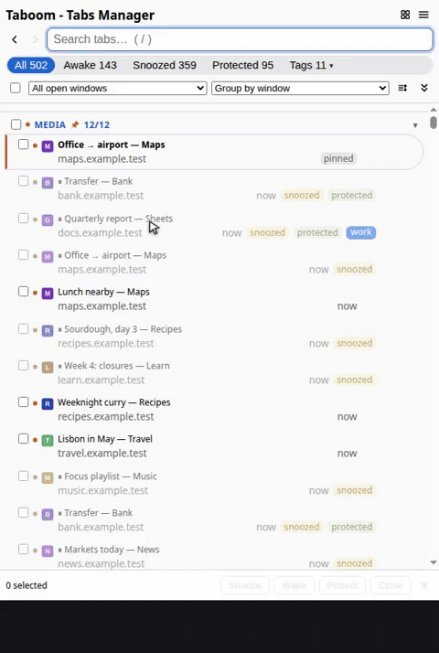
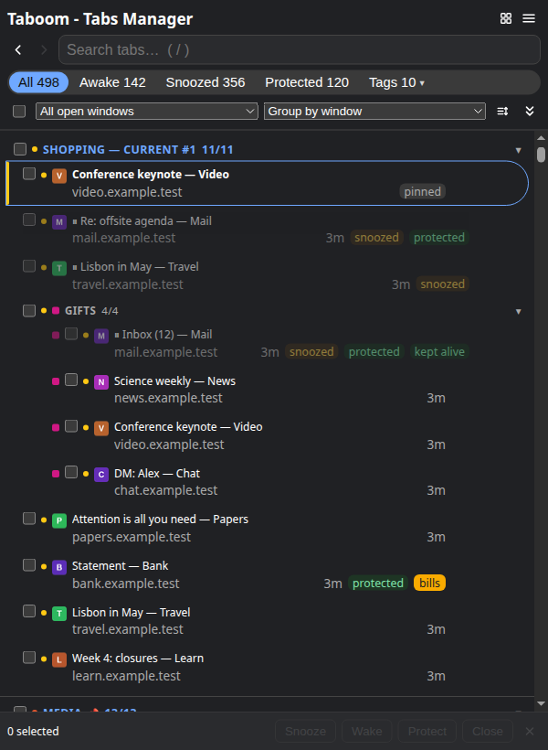
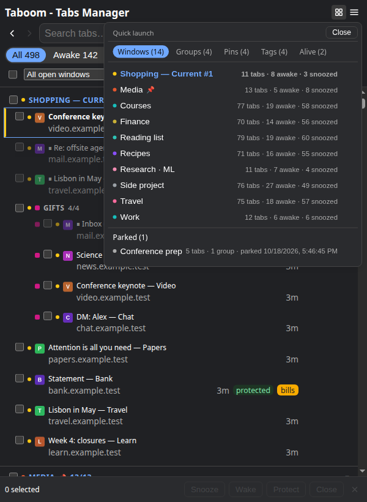
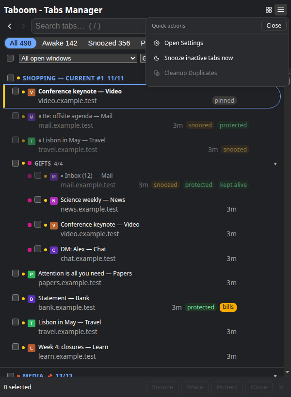
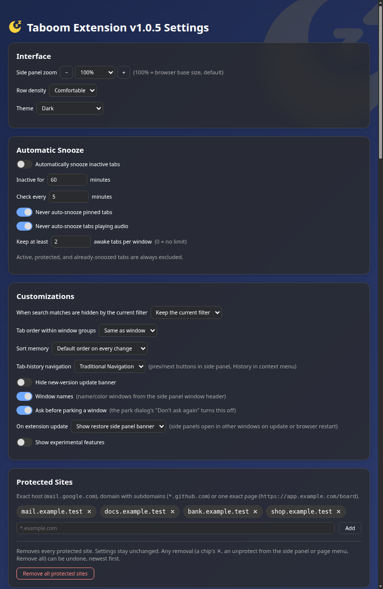

# Taboom - Tabs Manager - Chrome Extension

Search, protect, and snooze inactive Chrome tabs.

Taboom - Tabs Manager frees memory by snoozing (discarding) tabs you haven't used in a while — they stay in the tab strip and reload when clicked, nothing is ever closed automatically. A side panel lists all your tabs with instant search, filters, and bulk actions; sites that lose state on reload can be protected from snoozing. TypeScript, no runtime dependencies, runs fully locally with no telemetry.

  

* The [full feature demo](docs/assets/demo/taboom-demo.mp4) (MP4, ~4-5 minutes) walks through every feature with the matching Settings section beside the panel.

## Buy me Pizza/Coffee/Tea
* Like what I do? Taboom is free and stays free. If it saved you time or memory, you can support the next release: **[Buy me a coffee ☕](https://buymeacoffee.com/ariva)** — or scan the code.

## Installation

### Chrome Web Store
* **[Install from the Chrome Web Store](https://chromewebstore.google.com/detail/taboom-tabs-manager-by-ar/dllcchbdnomgagjlongoanjgolnjnegg?hl=en)**

### Local Installation
* Instructions: [docs/INSTALL.md](docs/INSTALL.md) — load unpacked in Chrome, requirements, troubleshooting

## Features

- **Side panel tab manager** — search across title/URL/hostname, filter by Awake / Snoozed / Protected, sort, and bulk snooze/protect/close.
- **Automatic snooze** — periodically discards tabs inactive past a configurable threshold, skipping pinned, audible, active, and protected tabs.
- **Site protection** — exclude sites (`mail.google.com`, `*.github.com`) or one exact page (`https://app.example.com/board`) from snoozing, also shielding them from Chrome's own Memory Saver.
- **Duplicates cleanup** — the quick launch lists every page open more than once; keep one copy across all windows or one per window, pinned copies and one New Tab per window always stay.
- **Park windows** — park a window: its tabs (order, pins, groups) and its name are saved and the window closes; restore it later as a new window or into the current one. Parked windows appear in the side panel's **Parked windows** scope with search and grouping and in the quick launch's Windows list, and single tabs can be moved between live and parked windows.
- **Keep tabs alive** — some sites log you out after a few idle minutes, dashboards go stale once the tab sleeps; mark such pages and they reload on a timer (session renewed, data fresh) and are never auto-snoozed.
- **Tags** — colored labels on pages: tag a tab from its row menu or the page's right-click menu, see the tag as a badge on every tab of that page, filter the list by tag, search with `#name`, group by tag, and manage tags and tagged pages in Settings. Tags follow the page address, so they survive restarts.
- **Context menu and keyboard shortcuts** for quick per-tab actions; `Ctrl+Shift+,` / `Ctrl+Shift+.` step back / forward through the tab history from any tab.

## Privacy first

- Collects nothing, tracks nothing — your browsing is yours
- Everything stays on your device
- No accounts, no analytics, no servers
- Open source

## Permissions

Taboom is a privacy-first extension. It requests the bare minimum Chrome permissions it can function with — no host permissions, no `scripting`, no content scripts, and it makes zero network requests; everything runs locally, and it never has access to the content of the pages you browse.

| Permission | Why it's needed |
|---|---|
| `tabs` | List tabs (title/URL) in the side panel, snooze (discard), activate, and close them |
| `tabGroups` | Show Chrome tab groups (title, color, collapsed) in the list, rename/recolor/collapse them, move tabs in or out |
| `storage` | Save your settings and protection rules locally (`chrome.storage.local`) |
| `alarms` | Run the periodic automatic-snooze check and the keep-alive reload sweep (survive service-worker sleep) |
| `contextMenus` | Right-click menu: snooze this tab, protect this site, keep this tab alive |
| `sidePanel` | Show the tab manager in Chrome's side panel |
| `favicon` | Show tab favicons from Chrome's local cache — no request ever goes to the site |

Nothing else is requested: Taboom cannot read or modify page content, cannot see your browsing beyond open tabs' titles/URLs, and sends nothing anywhere.

## Screenshots

Side panel:

  
  
  

Options page:

More in [Features](docs/FEATURES.md) — the demo retakes every screenshot on each build.

## Documentation

- [Installation](docs/INSTALL.md) — load unpacked in Chrome, requirements, troubleshooting.
  After installing, pin the Taboom - Tabs Manager icon via Chrome's puzzle-piece (🧩) menu so the side panel is always one click away.
- [Features](docs/FEATURES.md) — one picture per feature, the demo's own stills, with links into Usage.
- [Usage](docs/USAGE.md) — concepts, side panel, automatic snooze, protection rules, verifying freed memory.
- [Building](docs/BUILD.md) — every build command, what a build produces, the dev loop, the release checks, the optional minified build (with measurements).
- [Architecture](docs/ARCHITECTURE.md) — how the code is layered: service worker, side panel, options, the generic library, build and release.
- [Testing](docs/TESTING.md) — the four test tiers (unit, ui, real-browser, e2e), running them, layout and conventions.

## Licence

Free to use as a Chrome extension, personally or at work, as long as the extension itself is not monetized. Monetizing it in any form — selling it, charging for it, bundling it into a paid product or service, or publishing it on a store for a fee — requires explicit permission from Arunas Ivanauskas (arunas.work.hg [ AT ] [g] [m] [a] [i] [l] [.] [c] [o] [m]). See [LICENCE](LICENCE).
