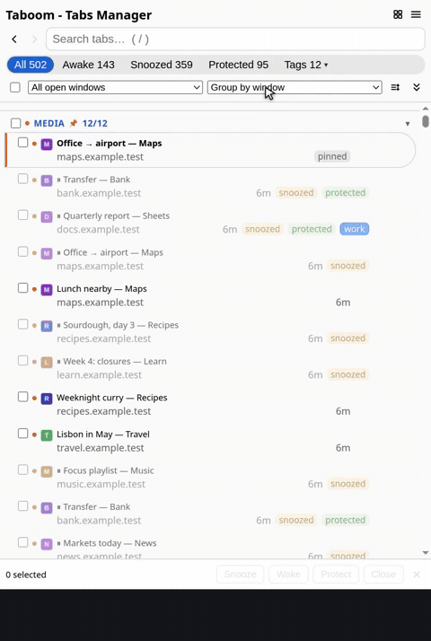
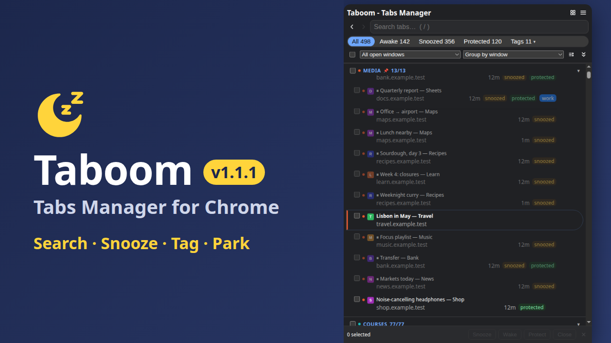
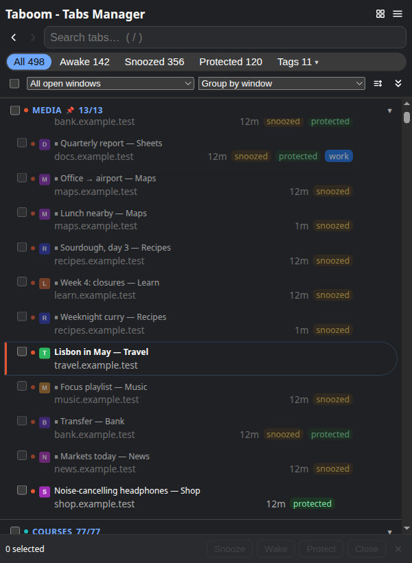
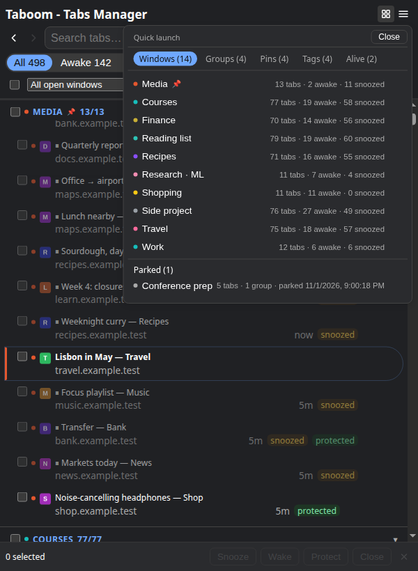
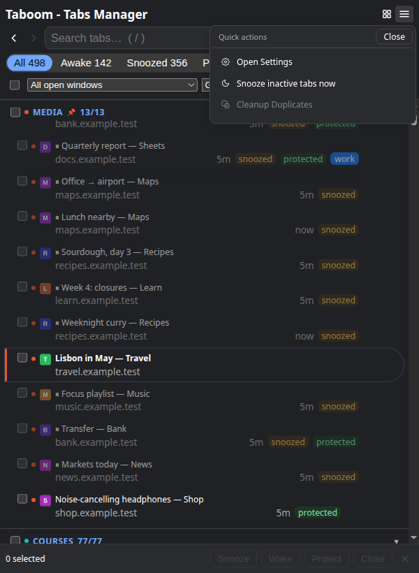
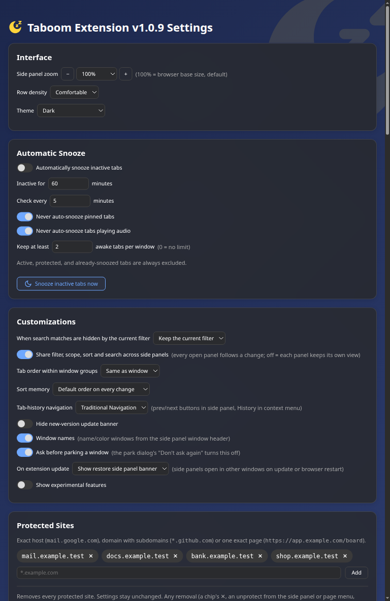

# Taboom - Tabs Manager - Chrome & Firefox Extension

[Install](#installation) · [Support](#buy-me-pizzacoffeetea) · [Features](#features) · [Privacy](#privacy-first) · [Permissions](#permissions) · [Screenshots](#screenshots) · [Docs](#documentation) · [Licence](#licence)

Search, protect, and snooze inactive tabs — in Chrome and in Firefox.

Taboom - Tabs Manager frees memory by snoozing (discarding) tabs you haven't used in a while — they stay in the tab strip and reload when clicked, nothing is ever closed automatically. A side panel lists all your tabs with instant search, filters, and bulk actions; sites that lose state on reload can be protected from snoozing. TypeScript, no runtime dependencies, runs fully locally with no telemetry.

  

  

* **[Watch the full demo on YouTube](https://youtu.be/HDdjwM7mcYY)** (5 minutes, with chapters) — every feature with the matching Settings section beside the panel.

## Buy me Pizza/Coffee/Tea
* Like what I do? Taboom is free and stays free. If it saved you time or memory, you can support the next release: **[Buy me a coffee ☕](https://buymeacoffee.com/ariva)** — or scan the code.

## Support
* Have a question, found a bug, or want to suggest a feature? Send me a message: **arunas.work.hg [ AT ] [g] [m] [a] [i] [l] [.] [c] [o] [m]**.

## Installation

### Chrome Web Store
1. **[Install from the Chrome Web Store](https://chromewebstore.google.com/detail/taboom-tabs-manager-by-ar/dllcchbdnomgagjlongoanjgolnjnegg?hl=en)** — click **Add to Chrome**, confirm.
2. **Pin it**: click the puzzle-piece 🧩 icon at the right of Chrome's toolbar, then the pin next to **Taboom - Tabs Manager**. The moon icon stays in the toolbar.
3. **Open it**: click the moon icon. The side panel opens with every tab of every window; it stays open while you switch tabs.

### Firefox
The same extension builds for Firefox 140+ (`just pack-firefox` → `dist/taboom-tabs-manager-v<version>-firefox.zip`); the Firefox Add-ons listing is in preparation. Until it is published: `about:debugging` → This Firefox → **Load Temporary Add-on** → the `manifest.json` inside the zip's folder (a temporary add-on is gone after a restart). The panel lives in Firefox's sidebar: the toolbar button toggles it, `Ctrl+Shift+Space` opens it. Two Chrome-only things are not there: split view (Chrome 155+) and cached favicons — Firefox rows show the site's initial instead, because showing the site's own icon would mean a request to the site. The same tour filmed in Firefox: [taboom-demo.gif](docs/assets/demo/firefox/taboom-demo.gif).

### Local Installation
* Developers: [docs/LOCAL_DEV.md](docs/LOCAL_DEV.md) — build from source and load unpacked in Chrome or as a temporary add-on in Firefox, requirements, troubleshooting

## Features

- **Side panel tab manager** — search across title/URL/hostname, filter by Awake / Snoozed / Protected, sort, and bulk snooze/protect/close.
- **Automatic snooze** — periodically discards tabs inactive past a configurable threshold, skipping pinned, audible, active, and protected tabs. **Snooze inactive tabs now** in Settings or the side panel's ☰ menu (or the page menu's **Snooze all inactive tabs**) snooze on demand every tab those rules allow, ignoring the inactivity threshold, timer on or off.
- **Site protection** — exclude sites (`mail.google.com`, `*.github.com`, `localhost:9000` for that port only) or one exact page (`https://app.example.com/board`) from snoozing, also shielding them from Chrome's own Memory Saver — for good, or for a while: the row menu's **Protect domain ▸** / **Protect URL ▸** submenu takes 1 hour to 1 week, the row reads *temporary protected* with the time left on hover, and Settings → Protected Sites lists every rule with its **Expires** and **Time left**, an **On** box to switch it off without losing it (the panel then shows the badge struck through) and drag-to-reorder.
- **Duplicates cleanup** — the quick launch lists every page open more than once; keep one copy across all windows or one per window, pinned copies and one New Tab per window always stay.
- **Park windows** — park a window: its tabs (order, pins, groups) and its name are saved and the window closes; restore it later as a new window or into the current one. Parked windows appear in the side panel's **Parked windows** scope with search and grouping and in the quick launch's Windows list, and single tabs can be moved between live and parked windows.
- **Split view** (experimental, Chrome 155+) — tick two tabs, or pick a partner from a row's menu, and Taboom puts them side by side in Chrome's split view (moving the partner next to the first tab if needed); **Unsplit** separates them. The layout itself (left / right or top / bottom) is Chrome's own split-view setting.
- **Keep tabs alive** — some sites log you out after a few idle minutes, dashboards go stale once the tab sleeps; mark such pages and they reload on a timer (session renewed, data fresh) and are never auto-snoozed. Mark the page (**Keep alive URL ▸**) or the whole site (**Keep alive domain ▸**, the host and its subdomains — one tab of it reloads per timer), for good or for 1 hour to 1 week (*temporary keep alive*, the time left on hover and in Settings); in Settings a mark can also be an address ending in `/` for everything under it or a pattern with `*`.
- **Tags** — colored labels on pages: tag a tab from its row menu or the page's right-click menu, see the tag as a badge on every tab of that page, filter the list by tag, search with `#name`, group by tag, and manage tags and tagged page rules in Settings. Tags follow the page address, so they survive restarts — with its `#fragment` by default (Settings → Tags → *Keep the #fragment*: hash-routed pages like `about:debugging#/runtime/this-firefox` are one page per route; an entry with a `#` is exact, one without covers every fragment). **Tag domain…** tags the whole host instead (the badge then reads `⌂ work`; `✱ work` for a pattern), and in Settings a tagged entry can be an address ending in `/` for everything under it, a host (`example.com`), a host with its subdomains (`*.example.com`) or a pattern with `*` anywhere (`https://github.com/ariva/*/test`); an entry can be switched off there without losing it — a switched-off tag or rule shows struck through in the side panel (rows, hover tip, Tags picker), or hides, per **Settings → Customizations**.
- **Tab names** — give a tab your own name: **Rename tab…** in its row menu, and the side panel shows that name in place of the page title (the hover tip keeps the real one, search finds both). Settings → Tab names holds the rules: a pattern (an exact page, a host, `*.example.com`, a `*` glob) and its name, an On box, how many open tabs it covers, drag to decide which rule wins. The browser's own tab strip keeps the page title.
- **Context menu and keyboard shortcuts** for quick per-tab actions — the panel's menus open (`.`) and work from the keyboard; `Ctrl+Shift+,` / `Ctrl+Shift+.` step back / forward through the tab history from any tab.

## Privacy first

- Collects nothing, tracks nothing — your browsing is yours
- Everything stays on your device
- No accounts, no analytics, no servers
- Open source

## Permissions

Taboom is a privacy-first extension. It requests the bare minimum permissions it can function with — no host permissions, no `scripting`, no content scripts, and it makes zero network requests; everything runs locally, and it never has access to the content of the pages you browse.

| Permission | Chrome | Firefox | Why it's needed |
|---|---|---|---|
| `tabs` | ✓ | ✓ | List tabs (title/URL) in the side panel, snooze (discard), activate, and close them |
| `tabGroups` | ✓ | ✓ (139+) | Show tab groups (title, color, collapsed) in the list, rename/recolor/collapse them, move tabs in or out |
| `storage` | ✓ | ✓ | Save your settings and protection rules locally (`storage.local`) |
| `alarms` | ✓ | ✓ | Run the periodic automatic-snooze check and the keep-alive reload sweep (survive background sleep) |
| `contextMenus` | ✓ | ✓ | Right-click menu: snooze this tab, protect this site, keep this tab alive |
| `sidePanel` | ✓ | — | Show the tab manager in Chrome's side panel (Firefox uses its sidebar, declared in the manifest, no permission) |
| `favicon` | ✓ | — | Show tab favicons from Chrome's local cache — no request ever goes to the site (Firefox has no such cache: rows show the site's initial) |

Nothing else is requested: Taboom cannot read or modify page content, cannot see your browsing beyond open tabs' titles/URLs, and sends nothing anywhere. The Firefox listing declares `data_collection_permissions: none` — nothing is collected.

## Screenshots

Side panel:

  
  
  

Options page:

More in [Features](docs/FEATURES.md) — the demo retakes every screenshot on each build.

## Documentation

- [Local development](docs/LOCAL_DEV.md) — build from source and load unpacked in Chrome, requirements, troubleshooting.
- [Features](docs/FEATURES.md) — one picture per feature, the demo's own stills, with links into Usage.
- [Usage](docs/USAGE.md) — concepts, side panel, automatic snooze, protection rules, verifying freed memory.
- [Building](docs/BUILD.md) — every build command, what a build produces, the dev loop, the release checks, the optional minified build (with measurements).
- [Architecture](docs/ARCHITECTURE.md) — how the code is layered: service worker, side panel, options, the generic library, build and release.
- [Testing](docs/TESTING.md) — the four test tiers (unit, ui, real-browser, e2e), running them, layout and conventions.
- [Chrome and Firefox](docs/CROSS_BROWSER.md) — what differs between the two browsers for an extension developer, and how this one source builds for both.

## Licence

Free to use as a Chrome extension, personally or at work, as long as the extension itself is not monetized. Monetizing it in any form — selling it, charging for it, bundling it into a paid product or service, or publishing it on a store for a fee — requires explicit permission from Arunas Ivanauskas (arunas.work.hg [ AT ] [g] [m] [a] [i] [l] [.] [c] [o] [m]). See [LICENCE](LICENCE).
