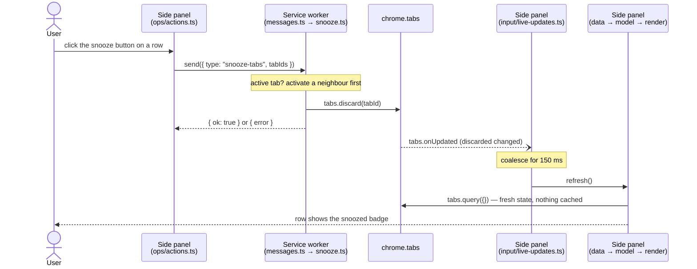

# Architecture

Taboom is a Manifest V3 Chrome extension written in strict TypeScript with vanilla DOM (no UI framework) and **no runtime dependencies**. [Vite](https://vite.dev) builds it into a plain, readable extension folder (`dist/prod`). Everything below points at code in this repository; when this page and the code disagree, the code wins.

Related docs: [LOCAL_DEV.md](LOCAL_DEV.md) (set up and load the extension) · [BUILD.md](BUILD.md) (build commands, release, minified build) · [TESTING.md](TESTING.md) (test tiers and layout) · [USAGE.md](USAGE.md) (what the extension does for a user).

## Layering — the one rule that shapes the tree

```text
src/lib/**         GENERIC — imports nothing from src/app, src/pages, src/background
tooling/**         GENERIC — Vite plugins, same rule
src/app/**         Taboom domain: pure logic (no DOM, no chrome.* calls) + the typed wiring of lib pieces
src/background/**  service worker: chrome.* effects, thin
src/pages/**       UI: DOM + chrome.* effects, thin; decisions live in pure model modules
```

Enforced mechanically, not by convention:

- `tests/structure/lib-boundary.test.ts` and the `noRestrictedImports` override in `biome.json` — generic code may not import Taboom code.
- `tests/structure/no-import-cycles.test.ts` — no runtime import cycles under `src/` or `tooling/`.
- `biome.json` `useBlockStatements` — braces on every `if`.

Working rules for new code: one file, one job (soft cap ~300 lines); decisions are pure functions, DOM / `chrome.*` code around them only reads inputs and applies results; every unit has its own test file in the matching `tests/` folder; module state has one owner and is exposed through functions, never an exported `let`.

## Runtime surfaces

| Surface | Entry | Role |
|---|---|---|
| Service worker | `src/background/service-worker.ts` | Registers every chrome event listener synchronously at module top level (MV3 requirement), in a fixed order, then delegates to feature modules. |
| Side panel | `src/pages/sidepanel/main.ts` + `src/pages/sidepanel/index.html` | Main UI. The entry only boots and calls `init*()` functions in listener-registration order. |
| Options page | `src/pages/options/main.ts` + `src/pages/options/index.html` | Six panes behind a tab strip (`nav.ts`): general settings, protected-site rules, keep-alive marks, tags, tab names, What's new; performance panel, reset / delete under General. |

The manifest is code: `src/manifest.ts` exports `manifest(version, target = "chrome")`, emitted as `manifest.json` by the build — one shared body, a tail per browser. Chrome: `minimum_chrome_version`, a service worker, `side_panel`, permissions `tabs`, `tabGroups`, `storage`, `alarms`, `contextMenus`, `sidePanel`, `favicon`. Firefox (`TARGET=firefox`): the same bundle as an event page (`background.scripts` — Firefox has no extension service workers), `sidebar_action` instead of the side panel, the permissions without `sidePanel` and `favicon` (an unknown permission makes Firefox refuse the add-on), `browser_specific_settings.gecko` (the AMO id, `strict_min_version` 140, `data_collection_permissions: none`). Both: `options_ui` in a tab. No host permissions, no content scripts anywhere. The extension makes **zero network requests**; `tests/e2e/smoke.spec.ts` asserts it on the built extension and `tests/structure/release-snapshot.test.ts` audits both release zips for network or dev-loop code.

The worker code runs unchanged as Firefox's event page because it already follows the event-page rules (listeners registered synchronously, no module state a decision depends on), and every `chrome.*` call site stays: Firefox's Manifest V3 `chrome` namespace returns promises like Chrome's. What differs between the browsers is fenced in `src/lib/platform/` (below) and in the manifest; nothing else may name a browser (`tests/structure/lib-boundary.test.ts`). Not available on Firefox and hidden by feature detection: split view (Chrome 155+ only) and the cached favicons (`_favicon/`, Chrome only — rows show the host's initial); the sidebar opens in the active window only (Firefox's `sidebarAction.open` takes no window); `tabs.onReplaced` is absent (Firefox keeps a tab's id across a discard). The developer's view of these differences — background model, manifest, API gaps, store review, tooling — is [CROSS_BROWSER.md](CROSS_BROWSER.md).

## Service worker (`src/background/`)

| Module | Owns |
|---|---|
| `service-worker.ts` | entry: all listener registrations + boot, no logic |
| `lifecycle.ts` | coalesced init pass (`onInstalled` / `onStartup`; each step isolated — one rejecting step is logged, the rest still run), update-available note |
| `snooze.ts` | the alarm, the auto-snooze pass, the pass after a browser start (`armStartupSnooze` on `runtime.onStartup`, `SNOOZE_ON_STARTUP` flag + `settings.snoozeOnStartupSeconds`, 0 = never: a one-shot `snooze-on-startup` alarm runs the on-demand pass — a delay kept in an alarm survives the worker sleeping; a delay under Chrome's 30 s alarm floor uses a timer instead, the worker being awake that long after the start event; the option is read again when the delay is over), manual snooze (a lone active tab gets a helper New Tab to take focus — removed again when Chrome refuses the discard), wake-time recording (`wakeTimes` writes on one chain, `withWakeTimes`) |
| `protection.ts` | protection rules → `autoDiscardable`, toggle / bulk protect (rule writes through `editProtectionRules` / `dropProtectionRules` in `src/app/storage.ts`), protect menu sync |
| `keep-alive.ts` | keep-it-alive: one 30 s sweep alarm (armed only while enabled and marks exist) reloads due pages and re-arms them with ±55 s jitter; overdue marks after a browser start (`runtime.onStartup`) or a sleep longer than their interval are staggered 30–60 s apart (`staggerKeepAlive`) instead of reloaded in one burst; the sweep re-reads the list after its reloads and re-arms against that, so a Settings edit made meanwhile survives; mark / unmark from menu and panel, by page or by site (`scope: "site"` — `siteOf`, like Tag domain…); the Keep alive ▸ Domain / Page checkbox items kept in sync; the sweep pass, the startup stagger and the re-enable restart run their read-modify-writes on one chain, so a sweep alarm due at browser start cannot race the stagger |
| `expiry.ts` | temporary rules and marks: one `expiry` alarm a minute apart while any entry carries `expiresAt` (`ensureExpiryAlarm`, re-checked by the message handlers and the storage listener), its sweep drops the expired ones through `dropProtectionRules` / `removeKeepAlive` — a removal like any other, so Restore brings one back — and re-applies `autoDiscardable`; not imported by `protection.ts` / `keep-alive.ts` (a cycle), the handlers in `messages.ts` arm it |
| `context-menus.ts` | browser context menu items, serialized rebuilds (`removeAll` in callback form: its Promise form is Chrome 123+, the minimum is 121), history menu |
| `tags.ts` | TAGS: the **Tag page ▸** submenu (one checkbox per tag, existing tags only), rebuilt on a `tags` / `ui` change, checks synced to the active tab; a click flips the tag on the clicked page through the storage writer. Registers its builder with `context-menus.ts` (which sits below it) |
| `tab-history.ts` | tab activation history (back / forward / jump), persisted stack (storage.local — survives worker sleeps and extension reloads; `resetHistoryOnStartup` empties it at a browser start, since Chrome reuses tab ids per session and a prune by "is it open" cannot tell a survivor from a newcomer); registered before `init` on `onStartup`, because same-event listeners run in registration order and both queue on the history chain; `historyStep` serves both the panel's message and the browser-wide keyboard command; jumps start one at a time so Chrome's activation echo of a jump never lands behind the next jump (key auto-repeat); only a tab that is gone leaves the trail on a jump — a window refusing focus keeps the tab its place; a close sweeps the stack through one `tabs.get` per distinct id, never a query over every tab |
| `window-profiles.ts` | window identity across restarts, names / colors / pins, side-panel port tracking, panels to restore. The profile pass runs on every worker wake; when the session map and every profile (minus its timestamp) match what is stored it writes nothing — `profilesUnchanged` / `sameSessionMap` in `src/app/window-identity.ts` — and a live window is restamped at most every 10 minutes for the TTL sweep |
| `parked.ts` | parked windows: `park-window` (snapshot written first, then `windows.remove`), `restore-parked` (one `openTabs` path for a new window or an existing one — one `tabs.create` per address so a refused address costs one tab, a refused seed address tries the next one for `windows.create`; the snapshot is consumed only after the tabs exist and only the tabs that opened leave it — by address (`removeParkedTabsByUrl`), not by position: a parked tab removed from another panel while a big restore opens its tabs shifted the positions and dropped the wrong one (reproduced in real Chrome, `tests/e2e/round3-races.spec.ts`) — so a refused address or a target window closed meanwhile stays parked instead of being lost; then pins / groups / active tab, identity re-applied through the window profile), `move-parked-tabs` (picked tabs into a live window / group / a new window; same rule — only the tabs that opened leave the snapshot). Every path where nothing happened — unknown id, window without tabs, every address refused, target group gone — answers `{ error: reason }` so the panel toasts it instead of a silent ok |
| `messages.ts` | `handleMessage`: exhaustive `switch` over the `Message` union |
| `gestures.ts` | keyboard commands and context-menu clicks; `open-row-menu` is the one command a page carries out — forwarded as a `PanelMessage` naming the focused window, and its panel opens the menu |
| `nav-mode.ts` | `effectiveFeatures()` — the stored state plus the flags with the experimental opt-in applied, the one read behind every "is this on for this user" question in the worker; cached feature flags (a failed `features.json` fetch is retried once after 500 ms inside the call; still failing, it is answered fail-closed once and fetched again on the next call, never kept for the worker's life) and effective navigation mode |
| `storage-changes.ts` | reaction to `chrome.storage.onChanged`; a `ui` write (every panel chip click) rebuilds the history / tag menus only when a key they read moved (`historyNav`, `showExperimental`, `tagPickOrder`, `tagSort`) |

The worker is stateless across suspensions: everything is recoverable from storage plus the Tabs API, and alarms are recreated on startup.

## Side panel (`src/pages/sidepanel/`)

`main.ts`, `index.html` and `sidepanel.css` sit at the top; everything else is grouped by what it is for:

| Folder | Modules |
|---|---|
| `foundation/` | `state.ts` (the `PanelState` singleton and state-derived predicates), `elements.ts` (static DOM references), `scheduler.ts` (render / refresh registry), `perf.ts` |
| `model/` | pure view models — `index.ts` is the barrel over `derived.ts`, `search.ts`, `filters.ts`, `groups.ts`, `windows.ts`, `rows.ts`; plus `sort-direction.ts`, `window-order.ts`, `tab-hosts.ts` |
| `render/` | `data.ts` (tabs, groups, stored state, window meta → `state`), `sorting.ts`, `render.ts`, `headers.ts`, `row.ts` (a playing tab's 🔊 is `RowViewModel.audio`, drawn in a fixed-height box after `.host-text` inside the flexible `.host` — not a badge, so it never competes with the tag pills and the emoji's font metrics never change the row height; with the `TAB_AUDIO` flag the same span is the mute toggle — `data-action="toggle-mute"`, 🔇 while `mutedInfo.muted`, shown on a silent muted tab too — and stays a `<span role="button">`: the row menu's Mute / Unmute is its keyboard path, and the flag-off markup is the one it always was), `hover-tip.ts`, `meta-fit.ts` (measures the row line and badge-font text widths for the tag-pill fit), `reveal.ts` (`revealRow`: "start" — the current row, or the Split / tab-group sub-header it sits under, at the top of the list (a tab switch, the panel opening, a view change); "nearest" — the minimal scroll for a row activated from the list, the whole block when it fits (last row 20 px above the bottom edge from below, header to the top edge from above); off-screen rows are `content-visibility` placeholders sized by `--row-h` from one measured row, exact only because every row has the same height — `.row .meta { min-height }` keeps a tag pill from running a third of a px over the text line, a mismatch that, times forty rows, moved the list ~15 px on every re-render wherever scroll anchoring could not hide it) |
| `ops/` | `actions.ts` (activate, snooze, wake, close — a multi-close asks through `lib/ui/ask-dialog.ts` like Park / Restore / New group —, pin, protect domain / url, copy urls), `answer.ts` (`reportAnswer`: the worker answers `{ error }` instead of rejecting, every awaited answer is checked there and toasted; chrome calls on a target that vanished — activate, move, focus — toast through `toastFailure` and refresh instead of rejecting; a close list that stopped at an already-closed tab closes the rest and says so), `window-ops.ts`, `tab-group-ops.ts`, `duplicate-ops.ts` (the confirmed duplicate cleanups, shared by the Dupes view and the ☰ menu), `parked-ops.ts` (Park window… with its dialog, the quick launch's confirmed restore, move / remove parked tabs, live tabs into a parked window — snapshot written in `closeTabs`'s `beforeClose` step, after the confirm — undo), `tag-ops.ts` (the entry keys behind rows — page or domain scope, filter by tag, recolor / remove / undo), `split-ops.ts` (runs a `splitPlan` against `chrome.tabs`: move, re-pin, group, `createSplit`; `unsplit`; feature-detected, the Split View API is untyped in `@types/chrome` 0.2.6) |
| `menus/` | `menus.ts` (row / window / tab-group menus; a negative id hands over to…) `parked-menus.ts` (parked window header, parked tab-group header and parked row menus), `tag-menu.ts` (the **Tag URL…** entry both row menus append, opening `input/tag-assign-picker.ts`, and the quick launch's tag menu), `split-menu.ts` (row menu's Split 2 selected tabs — exactly two ticked — and, whatever the selection, Split with previous tab / Split with next tab — the clicked row's list neighbours, each unless already split or the ticked partner, suffixed "(next window)" / "(previous window)" across a window boundary — / Unsplit; and the Split sub-header's menu: Unsplit — only with SPLIT_VIEW on and `tabs.createSplit` present, like the row items; the block itself renders from Chrome's state whatever the flag — + `appendCtxActions` over the pair, handed in by `list-context-menu.ts` so the file never imports `menus.ts` back), `list-context-menu.ts`, `quick-actions-menu.ts` (titlebar ☰: Open Settings, Snooze inactive tabs now, Cleanup Duplicates, Undo last remove in Parked windows; shown with `staysWhile: () => true`, so the refresh that follows focusing the panel's window does not close it; the row, tab-group and window header menus stay while every row they name is still there and close at the first missing one — the parked, tag, split and quick-launch menus close on any render) |
| `windows-popover/` | `popover.ts` (shell + Windows view; a view is offered only while it has something — Windows needs 2+ windows or a parked one, Groups 1+ group, the rest 1+ member — else the popover opens on the first one left; no view at all = `syncQuickLaunchButton` disables ▦ on every render), `groups.ts` (Groups view, new group, drag reorder), `pins.ts`, `alive.ts` (keep-alive marks), `duplicates.ts` (Duplicates view: tick rows, two cleanups), `parked.ts` (parked rows under the Windows view: newest first, confirmed restore on click, rename in place), `tags.ts` (Tags view: one row per tag, click filters the list, rename in place) |
| `dnd/` | `tab-dnd.ts` (the drag state ends on the source row's own `dragend`, which a mid-drag render detaches from the list), `drop-target.ts`, and the pure `dnd-model.ts` (`dropSpecFor`, `reorderedGroupTitles`) |
| `history/` | `history-nav.ts` (back / forward buttons, history popover, long-press) |
| `banners/` | `update-banner.ts`, `restore-banner.ts` (the port that marks this window's panel open, and the offer to reopen the panels other windows had before an update / restart — not made where a panel cannot be opened in another window (`capabilities.panelInAnyWindow`, Firefox): those windows are forgotten instead) |
| `input/` | `list-events.ts`, `toolbar-events.ts`, `quick-actions.ts` (☰ button; its own file because `menus.ts` imports `toolbar-events.ts`), `tags-chip.ts` (the Tags chip's picker popover: ticks drive `state.tagFilter`), `tag-assign-picker.ts` (the row menu's Tag URL… checklist popover: one checkbox per tag for the clicked rows, ticks staged behind Cancel / Apply, refilled on render), `keyboard-nav.ts` (the row cursor lasts one stretch of keyboard use: a window `blur` drops it; an arrow blurs the search so the list owns the keys — `Space` ticks the cursor row, `←` / `→` step the filter through `setFilter`, the chips' own click path — and `↑` on the first stop focuses it again; group headers are stops between the rows — `state.cursorGroup` names the header by its `data-group-key` while `state.cursor` is -1, and its keys click what the mouse clicks: the `.group-select` box for `Space`, the header for `←` / `→` / `Enter` by its `aria-expanded`; the menu keys go through `openListMenu`, the right-click's own picker in `menus/list-context-menu.ts`), `row-menu-keys.ts` (`.` / `Menu` / `Shift+F10` and the worker's `open-row-menu` message → `openMenuAtCursor`: the cursor row's menu, or the active tab's with no cursor, first item focused; swallows the browser's own `contextmenu` that follows a menu key), `global-keys.ts` (capture-phase Esc), `live-updates.ts` (chrome tab / storage events → debounced refresh — `tabs.onReplaced` included, `storage.local` only; a `windowProfiles` write counts only when `identityChanged` says a name / color / pin moved — the fingerprint rewrite on every tab event does not render) |

Dependency direction: `foundation` ← `model` ← `ops` ← `menus` ← `windows-popover` / `dnd` / `input` ← `main.ts`.

Two things worth knowing before changing this folder:

- **`foundation/scheduler.ts` inverts the render dependency.** Features call `render()` / `refresh()` through it and never import `render/render.ts` — that is what keeps the import graph acyclic. `main.ts` registers the real implementations first thing.
- **Listener order is behaviour.** Capture-phase Esc runs before the list's keydown (and stops there while the ask dialog or a tag picker is open: those own the Esc, the search must not clear underneath); the context-menu hide runs before the popover click-away; blur handlers go dropdown → context menu → popovers. The order is fixed in exactly two places: the bare `src/lib/ui` imports at the top of `main.ts`, and the `init*()` call sequence below them.

`src/background/`, `src/pages/options/` and `src/app/` stay flat on purpose: each file there is already one feature, and a folder per file would add depth without adding structure.

## Options page (`src/pages/options/`)

The page is six panes behind a tab strip under the title — General (Interface, Automatic Snooze, Customizations, Useful Links, Data, Performance, About), Protected sites, Keep alive, Tags, Tab names, Changes — one pane shown at a time (`nav.ts`): the URL hash is the only state, a pane name (`#tags`) or the id of an element inside a pane (`#rules-table` opens Protected sites and scrolls to its card — what the demo's `stage.settings()` and a docs link rely on); no hash means General, nothing is stored. A pane whose every card a flag hid has no tab (`syncSettingsTabs` after each render), and losing the selected pane that way falls back to General. The strip is a `tablist` with roving tabindex: arrows, Home and End move between the visible tabs; Back returns to the previous pane because the hash moved. Every card keeps its ids, so the feature modules, the tests and the demo address elements as before.

`main.ts` (entry, `render()`; its storage listener re-renders only the cards whose keys changed — a `ui` write that moves only the panel's view (filter / scope / sort / directions / quick-launch order) renders nothing, any other `ui` key renders every card — and a table holding an open inline editor is left alone until the edit ends), `page-state.ts` (feature flags, render forwarder, saved-flash), `restore-button.ts` (the three cards' "Restore last removal (N …)" button and tooltip), `settings-form.ts`, `ui-prefs.ts`, `rules.ts` (Protected Sites card: a table in the keep-alive shape — number with the drag grip, On checkbox (`setRuleEnabled`), click-to-edit pattern, Expires dropdown, Time left, Remove, rows reordered by drag (`moveItemTo` through `editProtectionRules`) — Add, Remove all, Restore last removal; both cards' in-place editors are `lib/ui/inline-edit.ts`, both cards' Expires / Time left cells `expiry-cells.ts`, ticked by the keep-alive card's one-second timer), `keep-alive.ts` (Keep Tabs Alive card: numbered marks table with pause checkbox, per-mark interval, click-to-edit address, 1 s countdown, Remove, drag-reorder of the rows (`lib/ui/row-reorder.ts` over `editKeepAlive` + `moveItemTo`), Add-by-address row, Remove all, Restore last removal), `tags.ts` (Tags card: tag table with color select, click-to-edit name, pages count, Remove, drag-reorder of the rows (`lib/ui/row-reorder.ts`, `moveTagTo` / `reorderTags`), header sort saved as `ui.tagSort` (`nextTagSort` / `sortedTags` in `src/app/tags.ts`; the `#` header clears it; drag off while sorted), the "Tags order in pickers" select (`ui.tagPickOrder`: stored / name / used / table — `orderedTags` turns it into the order every picker list uses), Add row; tagged-pages table with on/off switch (`editTagPage` / `setPageEnabled`), click-to-edit address, one toggle chip per tag, Remove, drag-reorder (`reorderTagPages`; off while `ui.tagPageSort` is set), Add-by-address row (`tagPageError` refuses junk and a key already listed — the row edit too); Remove all, Restore last removal), `whats-new.ts` (renders `CHANGES.md`), `perf-panel.ts`, `danger-zone.ts` (Restore defaults, Clear restore data — clears both undo stacks, disabled while empty — Delete all), and the pure `model.ts` (release-notes parsing, perf formatting, zoom presets). `useful-links.ts` (the Useful Links card: Chrome's list opens through `tabs.create`; without a side panel — Firefox — the second, static list shows instead, plain addresses because Firefox answers `tabs.create` of an `about:` page with "Illegal URL", a **Copy** button per address, and an **Open** button for the shortcut page when `shortcutSettingsOpener()` exists). `new-in-release.ts` (the card on top of the Changes pane: `renderNewInRelease(dateOf?)` lists `visibleHighlights()` — a block per release named in `VISIBLE_HIGHLIGHTS_RELEASES`, whatever the installed version; the card is headed "Highlights" whenever it shows; `GROUP_HIGHLIGHTS` picks one list (on) or a "New in v…" block per release under it (off; one release alone then shows without that sub-heading), none hides the card; rendered at once from bundled data, then again by `whats-new.ts` with the date `releaseDate()` reads from the release's `CHANGES.md` entry).

## Generic library (`src/lib/`)

| Module | What it is |
|---|---|
| `messaging.ts` | `createMessenger<Message, Responses>()` → typed `send()`. A message type without a response entry does not compile. `send()` never rejects: a worker that cannot be reached comes back as the same `{ error }` answer a throwing handler gives, so callers handle one shape and a fire-and-forget send cannot leak an unhandled rejection. |
| `storage.ts` | `createStorage<Schema>(area)` → typed `get` / `set` / `remove` over `chrome.storage[area]`. |
| `platform/capabilities.ts`, `platform/favicon.ts`, `platform/panel.ts` | The one browser-specific seam: feature detection (`tabGroups`, `sidePanel`, `panelInAnyWindow`, `sidebar`, `cachedFavicons`, `tabReplacement`; `shortcutSettingsOpener()` — Firefox's call that opens its shortcut page), the favicon URL (`undefined` without a cached store — the row shows the host's initial), the panel: Chromium's `sidePanel.open` / `setPanelBehavior`, Firefox's `sidebarAction.open` / a toolbar-click listener that toggles the sidebar (`toggleSidebarOnActionClick`, registered at worker start). App code asks for a capability, never for a browser name; browser-only names are allowed here and in `src/manifest.ts` only (`tests/structure/lib-boundary.test.ts`). Each browser's branch is also guarded by its build-time constant (`__CHROME__` / `__FIREFOX__`, `build-target.d.ts`), so the Firefox zip carries no `sidePanel` call and the Chrome zip no `sidebarAction` — a store validator never reads the other browser's code. |
| `ui/ask-dialog.ts` | confirm / prompt on the native `<dialog>`, optional swatches and a `validate` hook (a message keeps it open) |
| `ui/inline-edit.ts` | label → input editing, including "the press that ends an edit only ends the edit"; a host re-rendered mid-edit drops the edit (Chrome fires blur on the removed input — that blur never commits) |
| `ui/typing.ts` | `isBeingTyped(field)`: `input` fired, `change` / blur not yet — a form re-rendered on storage events skips such a field instead of overwriting the keystrokes |
| `ui/busy-button.ts` | `onBusyClick(button, run)`: disabled from the click until the awaited work settles, so a double-click on Restore pops one removal |
| `ui/row-reorder.ts` | `initRowReorder(tbody, onDrop)`: drag a `tr[data-key]` onto another, `.dragging` / `.drop-target` classes for the host's CSS, the keys to the writer on drop; `dragGrip()` the six-dot handle. Four Settings tables use it |
| `ui/context-menu.ts` | popover menu with hover-intent submenus, walked from the keyboard (capture-phase `keydown` while open: arrows / `Home` / `End` within one level, `→` / `Enter` into a submenu, `←` out; a key the menu takes never reaches the host's handlers; `focusCtxMenu()` for a menu opened by a key, and closing returns focus to where it came from; `role="menu"` / `menuitem`) (`ctxSubmenu(label, onClick)`: with `onClick` the parent's click is its own action and only hover opens the dropdown — the duration submenus); `showCtxMenu(…, { staysWhile })` decides whether a host render closes it — a list menu stays while every row it names is still there (a title tick no longer pulls it from under the pointer), a menu shown without it closes on the first render |
| `ui/dropdown.ts` | custom select that positions inside a side panel |
| `ui/toast.ts` | transient message; `toastFailure(what, error)` is the one wording for a failed action ("Could not …: reason") |
| `dom.ts` | `getElementById<T>`, `closest(eventTarget, selector)`, `mustQuery` |
| `list.ts` | `moveItemTo(list, keyOf, draggedKey, targetKey)`: the one drag-to-reorder rule (down lands after the target, up before it); `moveTagTo` is it over tag ids |

Taboom binds these in `src/app/`: `release-highlights.ts` (the new features of each release in a few words, from 1.1.0 on: `RELEASE_HIGHLIGHTS` keyed by version, `VISIBLE_HIGHLIGHTS_RELEASES` + `visibleHighlights()` for the Changes pane (which releases it lists — edited at release time), `releaseHighlights(version)`, `highlightText(version, key)` for a demo scene — the one wording Settings and the film share; a release with nothing new has no entry; `EVERYTHING_ELSE` + `everythingElse()` / `everythingElseText(key)` — the older features, the film's second group, not shown in Settings), `expiry.ts` (temporary rules and marks: the seven durations, `isExpired` / `unexpired` / `hasExpiring`, `temporaryUntil` for the badge, `expiryChoiceFor` for the Settings dropdown, `formatTimeLeft`), `messages.ts` (the `Message` union, `MessageResponses`, `send`), `snooze-now.ts` (one auto-snooze pass on demand and its status line, shared by the Settings button and the ☰ quick action), `storage.ts` (`localStore`, `sessionStore`, `loadState` / `saveState` with defaults merge, the list writers — protection rules on one per-context chain; every Settings edit of a mark or a page's tags goes through `editKeepAlive` / `setPageTag`, which read the stored list under the edit so a write from the panel or the worker in between survives), `types.ts` (domain types, `LocalStorageSchema`, `SessionStorageSchema`). The rest of `src/app/` is pure logic: `core.ts` (eligibility, rule matching, search helpers, defaults, feature flags), `keep-alive.ts` (keep-it-alive marks: list edits, jittered reload schedule), `tags.ts` (tags: the nine-color palette shared with tab groups, name rules, tag / tagged-page edits, undo hooks, the `#token` query split, `orderedTags` — the picker order `ui.tagPickOrder` asks for), `tag-patterns.ts` (what a tagged entry's `url` may be — an address, a host, `*.host` or a `*` glob — `tagPagePatternFromInput` and the one match rule `matchesTagPage`), `plural.ts` (`pluralize(count, noun)` — the one counter behind every "N tabs" in menus, prompts and quick-launch rows), `removal-trash.ts` (the undo stack both Settings cards share: `Removal<T>` actions, newest last, capped at 50), `duplicates.ts` (pages open more than once: `duplicateSets`, the keeper ranking and the two cleanup modes), `window-identity.ts`, `protection-rules.ts`, `env.ts`.

## Data flow

In short:

```text
pages ── chrome.tabs.query({}) ──► live tab state (never cached or persisted)
pages ── send(Message) ──► service worker ──► tabs.discard / rules / window profiles / history
service worker ◄── chrome.alarms ──► auto-snooze pass
everything ◄── localStore / sessionStore ──► settings, rules, ui prefs, window profiles, tab history, perf, wake times
```

The diagram below shows the same flow. Read it from left to right: the user does something, Chrome's state changes, and the side panel reads that state again and displays it.

- Solid arrows are calls; dashed arrows are events.
- The side panel is drawn twice, once for the code that acts on user input and once for the code that displays tabs. These two parts never call each other — every change goes through Chrome, and the display side picks it up from there.

```mermaid
flowchart LR
  user([User acts])
  triggers["Chrome triggers<br/>alarms · commands · contextMenus"]
  options["Options page<br/>src/pages/options"]

  subgraph act["Side panel — acting"]
    ops["ops · menus · dnd<br/>windows-popover"]
  end

  subgraph worker["Service worker · src/background"]
    swMessages["messages.ts<br/>(exhaustive switch)"]
    swFeatures["snooze · protection<br/>tab-history · window-profiles"]
  end

  subgraph chrome["Chrome — the only source of truth"]
    tabsApi["tabs · tabGroups · windows"]
    storageApi[("storage.local<br/>storage.session")]
  end

  subgraph show["Side panel — showing"]
    live["input/live-updates.ts<br/>(150 ms debounce)"]
    pipeline["render/data.ts refresh()<br/>→ foundation/state.ts<br/>→ model/* (pure)<br/>→ render/*"]
  end

  screen([User sees])

  user -->|clicks, keys, drags| ops
  ops -->|"send(Message)"| swMessages
  swMessages --> swFeatures
  ops -->|"direct: activate, close,<br/>pin, move, group"| tabsApi
  triggers -.->|"onAlarm (auto-snooze)<br/>onCommand · onClicked"| swFeatures
  swFeatures -->|"discard<br/>autoDiscardable"| tabsApi
  swFeatures <-->|"rules · window profiles<br/>tab history · wake times"| storageApi
  options <-->|"settings · rules · ui prefs"| storageApi

  tabsApi -.->|"tab / group / window events"| live
  storageApi -.->|onChanged| live
  live -->|refresh| pipeline
  tabsApi -->|"query — live state,<br/>never cached"| pipeline
  storageApi -->|loadState| pipeline
  pipeline -->|DOM| screen
```



Not drawn, to keep it readable: the side panel also writes its own UI prefs to storage (`src/pages/sidepanel/input/toolbar-events.ts`), and it holds a `runtime.connect` port named `sidepanel:<windowId>` so the worker knows which windows have a panel open (`src/background/window-profiles.ts`, `src/pages/sidepanel/banners/restore-banner.ts`); the port is reconnected at once when the worker is idle-killed — the worker's set of connected panels is memory, and a panel opening elsewhere in that gap would be offered this window as closed — with a 1 s back-off only for a port that died within a second of connecting (a worker that fails to start).

One round trip, end to end — the user snoozes a tab from the list:



The side panel never learns the result from the message reply — it re-reads Chrome. That is why the same path also covers tabs discarded by the auto-snooze alarm, by Chrome itself, or from another window's panel.

Design choices that matter:

- **No tab cache.** Every refresh re-queries Chrome; tab and storage events trigger a debounced refresh (`src/pages/sidepanel/input/live-updates.ts`).
- **`Tab.lastAccessed`** is the inactivity signal — no extension-side activity tracking.
- **"Not loaded" is one notion: `isUnloaded` in `core.ts`** — `discarded` (our `chrome.tabs.discard`) or `status === "unloaded"` (a tab Chrome restored at startup with its load deferred: Chromium's `extension_tab_util.cc` reports those with `discarded: false`). Every reader goes through it: auto-snooze eligibility and the per-window awake count, the panel's Awake / Snoozed filters and counts, the row's ⏸ / badge / snooze button, Wake, the duplicate ranking, the worker's manual snooze. The user sees one "snoozed" state; `status` changes (loading / complete) never trigger a render on their own — the title and favicon updates of a load do.
- **Snoozing the active tab** activates a neighbour first: Chrome refuses to discard the active tab (`src/background/snooze.ts`).
- **Protection has two effects:** excluded from the auto-snooze pass, and `autoDiscardable: false` on matching tabs (`src/background/protection.ts`). Every rule write — worker protect / unprotect, Settings Add row, chip edit, chip ✕, Restore — goes through `editProtectionRules` / `dropProtectionRules` / `restoreProtectionRules` in `src/app/storage.ts`, queued on one chain per context. A rule can be **temporary**: `expiresAt` set by the row menu's duration submenu (`protect-hosts` / `protect-urls` carry `hours`, `addHostRules` / `addUrlRules` stamp it) or Settings' Expires dropdown (`setRuleExpiry`); `isProtected` / `protectingRules` take `now` and skip an expired rule before the sweep (`background/expiry.ts`) drops it, so protection ends at the minute, and skip a **disabled** rule (Settings' On box, `setRuleEnabled`; `coveringRules` keeps it so `DerivedTab.protectionOff` can strike the badge through while `settings.showDisabledInPanel` is on — Protect over a page only disabled rules cover switches them back on instead of adding a twin), and `DerivedTab.protectedUntil` (`temporaryUntil`: every covering rule temporary → the latest end) drives the *temporary protected* badge and the tip's time left.
- **Keep-it-alive marks are keyed by a pattern**, not tab id: ids do not survive a restart, and one mark covers every tab under it. The pattern is the tagged-page vocabulary (`tag-patterns.ts`): a page address — made from a tab it drops the fragment (`keepAliveKey`), typed into Settings it keeps it, because hash-routed apps differ only there; a mark with `#` is exact, one without covers every fragment, one ending in `/` everything under it — a host and its subdomains (Keep alive domain: `siteOf`), or a `*` glob. `matchesKeepAlive` in `src/app/keep-alive.ts` is the single rule — `isSupportedUrl` (a reload needs a reloadable page) and `matchesTagPageKey` — and every comparison (sweep, badge, menus, Alive view, unmark, snooze eligibility) goes through it; `core.ts` cannot import it (the patterns read `core.ts`), so auto-snooze eligibility and the duplicate keeper ranking take an `isKept` predicate. A page mark is named by its tab, a domain / glob mark by itself (`keepAliveTitle`; the sweep renames page marks only) and opens as itself, a site's root or nothing (`keepAliveOpenUrl`). Each mark carries its own `minutes` (the default copied at mark time, so changing the default never silently reschedules old marks), an optional `paused` (absent = running; the mark is still a mark for the menu, the Alive view and snooze exclusion — only the sweep skips it) and its `nextReload`; toggling a mark's pause or re-enabling the feature restarts the schedule from now, so due times that passed meanwhile never fire together; a single 30 s sweep alarm (the MV3 floor) reloads the due ones and re-arms them at `interval ± 55 s`, floored to 30 s — a `periodInMinutes` alarm could not jitter; `nextReload` is an absolute time, so after sleep or a browser restart every mark is overdue at once: `staggerKeepAlive` re-times the overdue ones 30–60 s apart in list order (on `runtime.onStartup` for all of them; in the sweep for the ones more than one of their own intervals past their time — the sweep itself is never that late, so that is a sleep without a restart event), while `dueKeepAlive` (inside the interval, a quick restart included) still reloads, because a session timeout does not wait — reloading **one** tab per mark (`keepAliveTargets`: the pinned match, else the first in `tabs.query` order; a mark's `reloadAll` (its Tabs dropdown; absent = one tab) reloads every match — a page open twice shares one session, so one reload renews it) and taking the reloaded tab's title along so a mark's name follows the page (`setKeepAliveUrl` only renames hostname-titled marks, the Add row's placeholder). Kept pages are excluded from auto-snooze (manual snooze still works, as for protected) and carry a "kept alive" row badge (running marks only; paused ones show none, and the Alive view greys them out; that view lists every mark, open or not, striking through the ones with no open tab — `windows-popover/alive.ts`) derived once per refresh in `model/derived.ts`; the Settings Add row marks a typed address, host or pattern through `keepAliveUrlFromInput` (`tagPagePatternFromInput`, an address kept to http / https / file) and the same `markKeepAlive` the menu uses; pause / resume and remove from both pages go through the writers `pauseKeepAlive` / `removeKeepAlive` in `src/app/storage.ts`; **every removal is undoable**: `removeKeepAlive` / `clearKeepAlive` (the worker's unmark included) push the dropped marks as one `Removal<KeepAliveTab>` onto `keepAliveTrash` (`removal-trash.ts`: newest last, capped at 50 actions, no expiry), and `restoreKeepAlive` pops the newest, re-arming the returning marks from now and skipping pages marked again meanwhile. Protection rules get the same treatment: `dropProtectionRules(keep)` in `storage.ts` is the one door for removing rules (chip ✕, Remove all, the menu's "Remove site protection", the panel's Unprotect) and fills `protectionTrash`; `restoreProtectionRules` pops the newest, skipping patterns re-added meanwhile; the worker reapplies `autoDiscardable` on the `protectionRules` storage change either way (a not-open mark has no tab, so its menu — `openMarkMenu` — acts on the url); `autoDiscardable` is left alone because the next reload wakes a discarded tab anyway (`src/background/keep-alive.ts`, `src/app/keep-alive.ts`). A mark can be temporary too (`expiresAt`, from `keep-alive-set`'s `hours` or Settings' Expires → `setKeepAliveExpiry`): `isKeptAlive` / `keepAliveEntries` / `dueKeepAlive` skip it once expired, the expiry sweep removes it, `DerivedTab.keptUntil` names the *temporary kept alive* badge.
- **Filter, scope and sort are one shared view by default.** `ui.defaultFilter` / `scope` / `sort` are written by the panel's own clicks (`persistUiPrefs`; each written object sits in `state.pendingUiWrites` until its storage echo is skipped, a refresh that was already reading storage keeps the panel's own `ui` while a write is pending, and a foreign `ui` write clears the set) and seed a panel at boot. A foreign `ui` write (Settings' Restore defaults, another panel) reaches an open panel through `adoptStoredView` (`input/toolbar-events.ts`, called from the storage listener in `live-updates.ts`): with `ui.panelView = "shared"` (the default) the panel takes the stored trio as if clicked there — select values, sort direction, scroll and collapse resets, a parked-scope flip clears the selection — and writes nothing back; with `"independent"` it keeps its own view, and the store only seeds the next panel. Decided 2026-10-29: before, a panel kept its boot-time trio and its next click wrote it back over a reset. The Tags chip's ticks travel with the shared view the same way (`storage.session.sharedTagFilter`, `publishSharedTagFilter` on every tick / reset / quick-launch pick, `adoptSharedTagFilter`; no opt-out: they are a filter). The search text is part of the shared view too (no option of its own: the Settings toggle "Share filter, scope, sort and search across side panels" stands for `ui.panelView` shared / independent, and a search shared between panels that share no view makes no sense — decided 2026-10-30, replacing a separate `ui.searchShared` checkbox that lived one day): it travels through `storage.session.sharedSearch` — a session thing, not a preference: a panel opened later in the same browser session seeds from it, a browser start begins clean — written by `setQuery` once the keystrokes settle (300 ms, longer than a typing gap, so the other panels — all on the one main thread of the extension process, ~190 ms per 1100-row render — follow a pause, not every keystroke; 100 ms until 2026-11-05) and adopted by `adoptSharedSearch` (`input/toolbar-events.ts`, from the session branch of the storage listener); one `lastSharedSearch` variable is the text the store holds as far as the panel knows, so an adopted text is not written back; `ownWrites` lists this panel's writes whose echo has not arrived yet, and an echo found there is dropped without touching the box or the timer of the keystrokes typed since — the echo always lands after the next keystroke at typing speed, and late by several writes when many panels are busy, so matched against the current text it reset the box and lost characters (2026-11-05). Decided 2026-10-30. The Settings option "Switch to the All filter" (`ui.searchEmptyFilter`) changes the live filter only, never the stored one: `state.filterBeforeSearch` keeps the filter the search replaced and the end of the search (`setQuery("")`) brings it back, so every panel of a shared view ends a search on the user's filter — before, they stayed on All, and a click on the stored filter then wrote a value storage already held, which fires no `onChanged`, so the other panels never followed (2026-11-05). Every open panel runs on the extension process's one main thread, so what the OTHER panels do on a click is what the clicking one waits for (measured 2026-11-05 with 7 side panels on 1100 tabs: ~190 ms for the click's own render, ~1.7 s until the six others had re-queried and re-rendered). Two rules keep that small: a foreign `ui` write that moves the view only (`defaultFilter` / `sort` / `sortDirections`; the scope is not view-only, the Parked scope swaps the data set in `refresh()`) makes a shared-view panel `render()` without a refresh — after the same 150 ms wait as a refresh, so the panel that was clicked paints before the others start — and an independent-view panel do nothing (`movedOnly` in `live-updates.ts`; measured: an independent-view click went from ~1.7 s to ~0.4 s until every panel was idle, a shared-view one from ~1.7 s to ~1.55 s, the 1100-row DOM build being the floor); and a hidden panel (its window minimized or on another workspace, `document.hidden`) does no DOM work at all — the scheduler (`foundation/scheduler.ts`) turns every `render()` / `refresh()` asked for meanwhile into one refresh, `HIDDEN_REFRESH_MS` (10 s) after the last ask or at once on `visibilitychange` to visible, so a hidden panel is never more than 10 s stale and costs the visible ones nothing per click.
- **The panel's "current window" is the focused window, on purpose.** Every refresh takes `chrome.windows.getLastFocused({ windowTypes: ["normal", "popup"] })` (`render/data.ts`; a focused undocked DevTools or app window is skipped — the list never shows their tabs) into `state.currentWindowId`: the current-window scope, the window grouping's top group, the active-row mark, the keeper ranking and the history dot colors all follow the focus, so one panel drives every window and focusing window B makes A's panel show B on top. The "here" actions — Unpark into this window, the quick launch's new tab — use the same id, which is the panel's own window whenever they fire: a click or key in a side panel focuses the window that holds it. Only the panel-open port (`banners/restore-banner.ts`) asks `chrome.windows.getCurrent()`, because it names the window the panel lives in, whatever has focus. Decided 2026-10-29 against a separate `panelWindowId`; amended 2026-11-02 for Linux workspaces, where Chrome's own focus record lags: a window on another workspace is focused through the window manager, and Chrome keeps naming the window last used there (`getLastFocused`, no `onFocusChanged` for the asked one) until a real click on another window and back. The panel knows better twice, and says so through one **focus hint** (`state.focusHint`, `model/focus-intent.ts`): `askFocus` (`ops/focus-ask.ts`) records every window the panel asks Chrome for (row click, Focus window) and every window a press or key inside a panel proves focused (`input/live-updates.ts`; `state.panelWindowId` from `chrome.windows.getCurrent()` exists for that proof only), shows it as current at once and shares it through `storage.session.focusHint` so the other panels show it too. The right press that delivers such a proof is the window switch itself, so its `contextmenu` is swallowed (capture listener, same file): the user aimed at the window behind the panel, not at the row under the pointer; the next right-click, in a focused window, opens the menu. The hint outranks Chrome's record until the record names the hinted window, or until `windows.onFocusChanged` reports another window after the 1 s settle window (`hintSurvives`: a change inside it is the window manager's dance, one after it is the user moving focus). Not done, kept as a possible next step if the hint alone proves insufficient: a re-check 100 ms after the row click (`getLastFocused` + `tabs.query({ active, windowId })`, a `console.error` on a miss, then `windows.update` + `tabs.update` once more) — built and removed 2026-11-03, because the user's own console data showed the asked tab already active in the asked window and a second `windows.update` leaving Chrome's record as it was.
- **Duplicate cleanup never guesses which copy matters:** `rankKeepers` in `src/app/duplicates.ts` is the one ordering (pinned, kept alive, active in the current window, active, awake, most recent, first found) used by both cleanups and by the row click, pinned copies are never closed, and every New Tab spelling collapses into one set that keeps a copy per window whatever the mode — a blank tab is per-window clutter, not a page. The view lives in the quick launch (`windows-popover/duplicates.ts`) behind the `DUPLICATES` flag; ticks are module state reset on every ▦ open, and closing goes through the shared `closeTabs` with a confirm that names windows losing their last tab.
- **Window identity is recovered per window, on one write chain.** A window's name / color / pin hang on a logical id (`storage.session.windowSessionMap`: chrome id → logical id) backed by a content fingerprint in `storage.local.windowProfiles`. Chrome wipes `storage.session` on a browser restart (an extension reload may too), so every refresh runs `assignLogicalIds` (`src/app/window-identity.ts`): the map pruned of closed windows, then each window still without an id matched by fingerprint against the profiles no live window holds (`matchProfiles`, threshold-gated; a named profile wins a tie over an unnamed twin), and a fresh id only for a window nothing matches. The match is a similarity score, never an exact tab list: a window's fingerprint (`buildFingerprint`) is the set of hashes of `origin + path` per tab (query and fragment ignored, order and duplicates ignored), the same set for pinned tabs alone, the tab count and the window bounds; `scoreMatch` = 3 × Jaccard(pinned) + Jaccard(urls) + 0.25 when the tab count is within ±2 + 0.5 when the bounds are identical, Jaccard being shared ÷ union — so extra tabs count against a match as much as missing ones (10 old pages + 10 new = 0.5), two empty sets score 0, and pinned tabs dominate (the same pins alone score 3). Threshold 0.4 of a possible 4.75: half the pages shared is a match, a third is one only with a close tab count; a window of two unpinned tabs with one navigated away is not. Assignment is greedy over every (profile, window) pair above the threshold, best score first, each used once. The fingerprint is refreshed 400 ms after any tab create / close / move / attach, url or pin change, so at a restart "the window now" is compared with "the window at its last event". Never "recover once while the map is empty": session restore brings windows one at a time, and a window arriving after the first pass met a half-filled map, got a new id and its name was stranded. Side effect: "Reopen closed window" finds its old profile. Every read-modify-write of `windowProfiles` — the debounced refresh, the panel-open refresh, renames, park-restore — is queued on one chain in `src/background/window-profiles.ts`; a refresh interleaving with a rename would otherwise write its stale copy over the name. A patch (rename, color, pin, panel-open) for a window with no profile refreshes first — not only when the window is unmapped, also when it is mapped but the profile is gone, as after Settings → Delete all (`storage.local.clear()` takes the profiles, `storage.session` keeps the map) — so the first rename after a reset lands instead of being skipped. The match also brings back the profile of a window closed and reopened in the same session (Ctrl+Shift+T) — its name, but not its `panelOpen`: the refresh records when this session first built the map (`storage.session.identitySessionStart`), and a profile written after that moment that lands on a window the map did not know was closed with the flag left behind (no worker alive to see the port drop, or a flag carried over a restart that nothing cleared), so the flag is dropped; a restart's late-restored window carries a pre-session profile and keeps it, which is the case the restore banner exists for.
- **Read-modify-write keys have one writer chain per context.** `chrome.storage` has no transactions: two handlers that both `get` a list before either `set`s it lose the first write (closing the active tab fires `onActivated` and `onRemoved` at once; the panel reports woken tabs one message each; a menu toggle and a panel message protect at the same moment). The keys with a chain: `tabHistory` (`withHistory`, `tab-history.ts`), the context menu tree (`enqueueMenuOp`, `context-menus.ts`), `windowProfiles` + `windowSessionMap` (`queued`, `window-profiles.ts`), `wakeTimes` (`withWakeTimes`, `snooze.ts`), `protectionRules` + `protectionTrash` (`queuedRules`, `src/app/storage.ts` — the one chain a page shares with the worker's code, each context running its own). `keepAlive` has no chain: the sweep's window is its reloads, so it re-reads the list after them and re-arms against that. A chain serializes one context only; a Settings page writing while the worker writes the same key is still last-writer-wins, with the window shrunk to one storage round trip.
- **Parked windows are rows with negative ids.** The Parked windows scope swaps `state.allTabs` / `tabGroups` / `windowMeta` for the synthetic set `parkedPanelTabs` builds (`src/app/parked.ts`: window `-(1 + w·100000)`, tab `-(1 + w·100000 + t)`, group `-(2 + …)`, so `-1` stays "no group"; the ids are positional, so `refresh` clears the selection when `parkedLayoutKey` — which windows, which tabs in which order — differs from the last refresh: an edit elsewhere would otherwise leave the ticks on other tabs), and `state.liveTabs` / `liveTabGroups` / `liveWindowMeta` keep the real ones for the surfaces that must stay live there (quick launch, duplicates, window labels, move targets; `state.liveWindowMaps` is `windowMaps` over that set, computed once per refresh; id → tab goes through `tabById` — `state.tabsById`, shown ∪ live, rebuilt per refresh, ids never collide since parked rows are negative — or `actionableTabs()` where a list is needed, so a quick-launch Pin or Group acts on the live tab while the list shows snapshots). The quick launch's Windows view lists the parked windows too (rows keyed by the same negative ids, so one `windowId < 0` test routes their ⋯ / right-click to `openParkedWindowMenu`, handed a popover host for rename-in-place and the jump to the scope). Search, filters, sorts, headers and selection then work unchanged; `parkedRef(id)` is the one test that routes a row to the parked menus and keeps `activate` and the hover actions away from it. The snapshot is written before the window closes, and restore is one path (`openTabs`) whether the target is a new window or an existing one.
- **Tags are labels on page addresses, derived once per refresh.** `tags` (id, unique case-insensitive name, Chrome group color, optional `disabled` — `enabledTags` filters it out of every surface but Settings; while `settings.showDisabledInPanel` is on (default) the panel shows it struck through instead: `offTagsForUrl` gives `DerivedTab.offTags` (the tags a url gets only through a disabled tag or an off entry — pills with kind `tag … off`, the hover tip's `TipTag.off`, the Tags filter and its counts see them, `#name` search and Group by tag do not), `orderedTags(…, includeDisabled)` lists it in the Tags chip picker and the quick launch Tags view, and a paused keep-alive mark is `DerivedTab.keepAlivePaused` — a struck-through `kept alive` badge) and `tagPages` (an entry per pattern → tag ids — `setPageTags` with an empty set keeps the entry tagless, Settings' ✕ / untick leave the row for Remove; `togglePageTags`, the panel's and the worker's door, drops an entry its last untick empties; `renameTagPage` re-keys one in a single write —, optional `disabled` — an off entry is kept in Settings and skipped by `tagsForUrl` / `inheritedTagIds`, so it tags nothing (its tags come back struck through through `offTagsForUrl`); the writers keep the flag when they rewrite an entry; the pattern is a page key — the url, with its fragment while `settings.tagPagesKeepFragment` (default on) says so: `tagPageKey(url, keepFragment)` decides at the three doors where a tab becomes a key (the panel's `tagPageUrls`, the worker's `toggleTagForTab`, Settings' typed Add / edit, which strip the hash before normalizing when off), and `matchesTagPageKey` applies keep-alive's rule — an entry with a `#` compares against `PageKey.url` (the full address: exact, prefix and glob alike), one without against the fragment-free `key`, so old entries keep covering every fragment; `isAddressPattern` is "has a scheme", so `about:debugging#/setup` is an address like `https://…` (before, a scheme without `//` fell through to the host rules and never matched) and `localhost:9000` — digits up to the end or a `/` — is a host with a port, not a scheme; every host comparison (protection rules, sites, keep-alive, `siteOf`, the panel's Protect domain and the page menu's Protect site) goes through `hostOf` in `core.ts` — `URL.host`, the hostname plus a non-default port — and `matchesRule`: a pattern naming a port covers that port only, one without drops the port before comparing and covers every port, as every rule saved before ports were understood expects; ending in `/` it is a prefix, so a root address covers the site without a `*` — or, since 1.0.7, a site (`a.test`: the host and its subdomains, matched through `matchesRule` as `*.a.test` — tags differ from protection rules here, where a bare host is exact; `*.a.test` stays as the same thing), since 1.0.8 a word (`youtube`, no dot: every host containing it, a ✱ pattern) or a glob with `*` anywhere, `*` matching anything `/` and `?` included; `tag-patterns.ts` normalizes a typed one and `matchesTagPage` is the one match rule — `pageKeyOf` resolves a url once per tab and `matchesTagPageKey` matches every entry against it, so a refresh parses 1000 urls, not 1000 × entries; a glob is walked segment by segment — first segment opens the text, last closes it, the rest found in order — never a RegExp, whose `.*` chain backtracks exponentially on a non-matching page) are the two lists; a tab gets the union of every entry covering it (`tagsForUrl`); the writers edit entries by their own key and never what a pattern covers, so the row menu's **Tag domain…** writes the host entry (`siteOf`: a leading www. dropped) and a tag a page only inherits from a wider entry shows ticked and locked in the Tag URL… picker (`inheritedTagIds`); `tagOriginSets` / `tagOrigins` say which entry kinds hand a tag to a url (page / domain / pattern — `tagPatternKind` classifies a stored pattern), `DerivedTab.tagOrigins` carries the winning one and `rows.ts` prefixes the pill label with ⌂ / ✱ (part of the label, so the pill fit measures it); `tabsLosingTag` simulates an untick over the open tabs, and the panel picker (Apply, Enter, the click-outside question) and the Settings chips / picker ask before a change that reaches more than one tab — the panel's `askDialog` brings the picker back with its ticks on Cancel — it is edited in Settings → Tagged page rules, where a row's address edit and the Add row take any of the forms and a Tabs column counts the open tabs the entry covers (`chrome.tabs.query` at render time, no tab listeners — the page re-renders on every write); its headers sort like the tag table's (`ui.tagPageSort`, `sortedTagPages`, the same `nextTagSort` cycle); `model/derived.ts` joins them into `DerivedTab.tags` (and appends the names to the search haystack), so badges, the Tags chip, `#token` search (`splitTagQuery` in `src/app/tags.ts`: strict prefix on the name, outside the fuzzy ranking), Group by tag (first tag in tag-list order — rows are keyed by tab id, so a tab sits under one header) and the quick launch all read one source; parked rows carry real urls and get tags for free. A row shows as many pills as its meta line holds, then `+N`: `fitTagPills` in `model/rows.ts` is pure and mirrors the CSS widths (gap, paddings, host floor, action buttons); `render/meta-fit.ts` feeds it the measured line (from the first rendered row, like `--row-h`) and canvas `measureText` widths in the badge font (cached per label, no layout per row). When the measurement changes after a render — first paint, a resize (`ResizeObserver` on the list), a font-size setting — the list renders once more in the same task, so nothing flashes; without a measurement (happy-dom) the fit falls back to three pills. Every list edit goes through the writers in `src/app/storage.ts` from the panel, Settings and the worker alike; removals (a tag with the page ids it takes along, or whole pages) land in `tagTrash` as one `Removal<TagRemoval>` and `restoreTags` merges them back, skipping a tag whose name was taken meanwhile. The Tags chip is a filter button like the other four, with its own picker popover (`input/tags-chip.ts`) driving the session-only `state.tagFilter` (empty = any tag, ticks = OR); its count and dot have their own classes so the four plain chips' `.count` set stays what it was. Everything is behind the `TAGS` flag (shipped on).
- **Custom tab names are rules, not tab state.** `tabNames` (`TabName`: a pattern in the tagged-page vocabulary → a name, optional `disabled`) is a list the panel reads once per refresh: `tabNameFor` in `src/app/tab-names.ts` gives `DerivedTab.name` — the first enabled rule in stored order wins, so the Settings drag order is the precedence and a rename from the row menu (`setTabName`) puts its new rule first, where it beats a wider rule already naming the page. `rows.ts` shows the name as the title (search ranges land on it; the name joins the haystack) and opens the hover tip with the tab's own title. The browser's tab strip is out of reach — a content script would be a new permission — so the name lives in the panel only. The row menu's **Rename tab…** (`ops/tab-name-ops.ts`, a single tab, the ask-dialog prefilled with the shown title; a blank answer drops the page's own rule through `dropTabNames`, restorable) and Settings → Tab names (`options/tab-names.ts`: the protected-sites table shape with the name as a second editable cell, a Tabs count from `chrome.tabs.query` at render time, the Add row in the table's foot) write through `editTabNames` / `dropTabNames` / `restoreTabNames` in `storage.ts`; removals land in `tabNamesTrash`. Behind the `TAB_NAMES` flag (shipped on).
- **Split view is Chrome's pairing, Taboom only gets the tabs there.** `chrome.tabs.createSplit` (155+) takes exactly two adjacent tabs of one window with equal pin and group state and offers no layout choice; `splitPlan` in `src/app/split.ts` works out how the partner adapts to the anchor (the clicked tab stays put): `adjacentMove` (final-index semantics of `tabs.move`: a partner left of the anchor lands at the anchor's own index), the pin state to set (a mismatch, or the pin a cross-window move loses — `split-ops.ts` re-reads both tabs after pinning and seats the partner again, since pinning moves a tab into the pinned run), the group to join or leave; only an already-split tab or the same tab twice is refused. Chrome's rules (Chromium `chrome/browser/extensions/api/tabs/tabs_api.cc`, `TabsCreateSplitFunction::Run`), refused in this order: same tab twice ("Cannot create a split view with duplicate tab IDs"), a tab already split, different window, pin mismatch, group mismatch (each "Cannot create split view with tabs of mismatching '…' states"), non-adjacent ("Cannot create split view with non-adjacent tabs"). Allowed: both pinned, both in the same group. `tabs.update({pinned})`, `tabs.group` and `tabs.ungroup` on one member apply to the whole split (the API extends the affected set to the split's tabs), so a pair never drifts apart through those calls. In the list a pair reads as one block: `keepSplitPairsTogether` (end of `selectVisible`) seats the partner right after the first member whatever the sort, and `splitPairEdges` over the visible order says where the pair sits: `render.ts` puts a **Split** sub-header (`renderSplitSubheader` in `headers.ts`, the tab-group sub-header shape with a divided-window icon, no collapse) before the first row and the rows get `in-split` plus `split-first` / `split-last` (the tab-group indent, one level deeper inside a tab-group run; one tint and joined corners, no bracket) — a member whose partner is filtered out is "only": header 1/2 over its single row.
- **Tabs with sound are one predicate.** `hasSound` (`src/app/core.ts`): audible or muted — a muted tab counts while silent, or a list of sounding tabs would hold nothing to unmute. The `audio` filter chip, its count, its visibility (`render/data.ts`: shown only while a listed tab has sound, and a list filtered by it goes back to the filter the chip replaced — `state.filterBeforeAudio`, set where the filter changes, `setFilter` and `adoptStoredView` — when it goes) and the `:audio` search token (`splitQuery` in `model/search.ts`, which also keeps the token out of the highlight words) all read it. Muting is `chrome.tabs.update(id, { muted })` from the panel (`ops/actions.ts` `muteTabs`), no worker message and no permission beyond `tabs`; `mutedInfo` is in `RENDERED_TAB_PROPS`, so a mute made in the browser's tab strip repaints the panel. Known side effect, Chrome's rule and not ours to change: `tabs.update({ muted })` marks the tab's mute as an extension's decision (`mutedInfo.reason`), for an unmute too, and Chrome's site-level **Mute site** then skips that tab — no API clears the mark; the panel still shows the tab's real state. Auto-snooze still reads `audible` alone. A chip and a search token, not a quick-launch view: the rows keep their menu, selection and keyboard, and nothing new has to be kept in step with them.
- **Feature flags** live in `features.json` (`enabled`, optional `experimental`); flag names are a type (`FeatureName` in `src/app/types.ts`), so a misspelled flag does not compile. A missing capability or a disabled flag hides the feature — the test suite runs every flag-dependent test with flags as shipped, with experimental flags on, and with everything off (`vitest.config.ts`).

## Storage and messages

The types are the authoritative definitions — they are not repeated here:

- storage keys and shapes: `LocalStorageSchema`, `SessionStorageSchema` in `src/app/types.ts`
- messages and their responses: `Message`, `MessageResponses` in `src/app/messages.ts`; the worker → panel direction is `PanelMessage` there (one member, no answer read)

Missing keys are backfilled from `DEFAULTS` (`src/app/core.ts`) on every `loadState()`, so partial writes are safe. Bump `schemaVersion` and add a migration in `src/app/storage.ts` when a stored shape changes incompatibly. Tab activation, close and plain reads go straight from the pages to `chrome.tabs` — no message hop.

## Build, dev loop, release

How to run it — commands, outputs, release steps, the minified option: [BUILD.md](BUILD.md). This section is about where each piece lives.

| Piece | File |
|---|---|
| Build config — pages as Vite root (so they land at `sidepanel/index.html`, `options/index.html`), worker as a third entry with a stable name, unhashed readable output, `base: "./"`, no module-preload polyfill (MV3 CSP), `target: chrome121` (`firefox140` for `TARGET=firefox`); `TARGET` also picks the manifest, the output folder (`dist/chrome` / `dist/firefox`, `dist/dev-chrome` / `dist/dev-firefox`), the dev-reload port and defines `__CHROME__` / `__FIREFOX__`, the constants that cut the other browser's branch out of the panel seam, unminified unless `MINIFY=1` | `vite.config.ts` |
| Emits `manifest.json` from `src/manifest.ts` for the build's target; the version lives in `package.json` only | `tooling/manifest-plugin.ts` |
| Emits root files the runtime fetches (`features.json`, `CHANGES.md`), the extension icons (`icons/prod` → `icons/`) and the dev-only blue icons (`icons/dev`, never in `dist/prod`) — Vite's `publicDir` is off because it cannot exclude files from production | `tooling/static-files-plugin.ts` |
| Dev loop: in a development watch build, serves an HTTP long-poll; after each rebuild open extension pages reload themselves, or call `chrome.runtime.reload()` when the worker, manifest or shared code changed. Never part of a production build. | `tooling/dev-reload-plugin.ts`, pure part in `tooling/dev-reload-core.ts` |
| Release gate: version newer than the last `release-v*` tag, CHANGES entry present, CHANGES commit hashes valid, `just check`, real-browser tier, pack (the Chrome zip, then the Firefox zip with `web-ext lint`), e2e smoke on the packed build; `scripts/source-zip.sh` makes the source archive AMO asks for | `scripts/build.sh`, `scripts/validate_versions.sh`, `scripts/validate_hashes.sh`, `scripts/validate_code.sh`, `scripts/pack.sh`, `scripts/source-zip.sh` |
| Task runner (`just dev`, `check`, `test`, `test-browser`, `test-e2e`, `build`, `format`) | `justfile` |
| Lint + format | `biome.json` |
| Type check (strict, `noUncheckedIndexedAccess`, `erasableSyntaxOnly`, no emit — Vite transpiles, `tsc` only checks) | `tsconfig.json` |

## Tests

`tests/` mirrors `src/`, subfolders included (`tests/app`, `tests/lib`, `tests/background`, `tests/pages`, `tests/tooling`), plus `tests/structure` (repo-wide guards and release packaging), `tests/browser` (Vitest Browser Mode in real Chromium and Firefox — focus, clicks, popovers, dialogs, drag & drop), `tests/e2e` (Playwright on the built extension, Chromium) and `tests/helpers` (the typed `chrome.*` mock — in Chrome's or Firefox's API shape —, the happy-dom harness, DOM lookup helpers). The flag-dependent suite runs four times: three flag scenarios and once against the Firefox-shaped mock. Configs: `vitest.config.ts`, `vitest.browser.config.ts`, `playwright.config.ts`. Details: [TESTING.md](TESTING.md).

The demo (`demo/`) and the performance tier (`tests/perf/`) drive a real browser with the built extension through one set of interfaces (`demo/page-api.ts`): Chromium behind Playwright (`demo/browser.ts`, `demo/playwright-page.ts`, `demo/recorder.ts` — DevTools screencast), Firefox behind a WebDriver BiDi client of our own (`demo/firefox/`: a prepared profile, `webExtension.install`, the panel page in a tab, screenshot polling) because Playwright cannot load an extension into Firefox. The world builder (`demo/world.ts`) and the scenes know neither.
