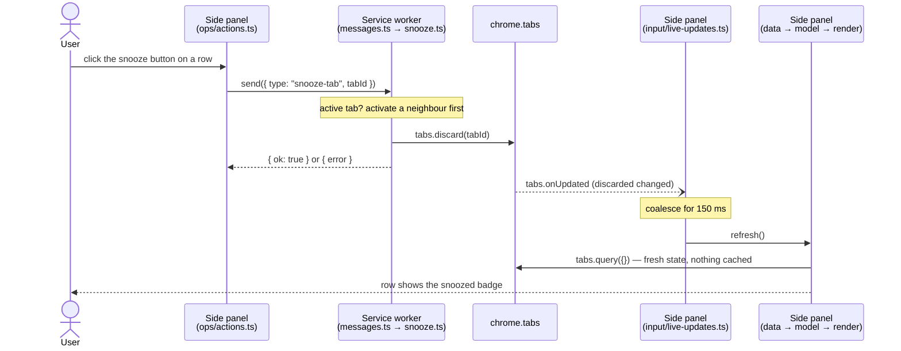

# Architecture

Taboom is a Manifest V3 Chrome extension written in strict TypeScript with vanilla DOM (no UI framework) and **no runtime dependencies**. [Vite](https://vite.dev) builds it into a plain, readable extension folder (`dist/prod`). Everything below points at code in this repository; when this page and the code disagree, the code wins.

Related docs: [LOCAL_DEV.md](LOCAL_DEV.md) (set up and load the extension) · [BUILD.md](BUILD.md) (build commands, release, minified build) · [TESTING.md](TESTING.md) (test tiers and layout) · [USAGE.md](USAGE.md) (what the extension does for a user).

## Layering — the one rule that shapes the tree

```text
src/lib/**         GENERIC — imports nothing from src/app, src/pages, src/background
tooling/**         GENERIC — Vite plugins, same rule
src/app/**         Taboom domain: pure logic (no DOM, no chrome.* calls) + the typed wiring of lib pieces
src/background/**  service worker: chrome.* effects, thin
src/pages/**       UI: DOM + chrome.* effects, thin; decisions live in pure model modules
```

Enforced mechanically, not by convention:

- `tests/structure/lib-boundary.test.ts` and the `noRestrictedImports` override in `biome.json` — generic code may not import Taboom code.
- `tests/structure/no-import-cycles.test.ts` — no runtime import cycles under `src/` or `tooling/`.
- `biome.json` `useBlockStatements` — braces on every `if`.

Working rules for new code: one file, one job (soft cap ~300 lines); decisions are pure functions, DOM / `chrome.*` code around them only reads inputs and applies results; every unit has its own test file in the matching `tests/` folder; module state has one owner and is exposed through functions, never an exported `let`.

## Runtime surfaces

| Surface | Entry | Role |
|---|---|---|
| Service worker | `src/background/service-worker.ts` | Registers every chrome event listener synchronously at module top level (MV3 requirement), in a fixed order, then delegates to feature modules. |
| Side panel | `src/pages/sidepanel/main.ts` + `src/pages/sidepanel/index.html` | Main UI. The entry only boots and calls `init*()` functions in listener-registration order. |
| Options page | `src/pages/options/main.ts` + `src/pages/options/index.html` | Settings, protected-site rules, What's new, performance panel, reset / delete. |

The manifest is code: `src/manifest.ts` exports `manifest(version, target = "chrome")`, emitted as `manifest.json` by the build. Permissions: `tabs`, `tabGroups`, `storage`, `alarms`, `contextMenus`, `sidePanel`, `favicon` — no host permissions, no content scripts. The extension makes **zero network requests**; `tests/e2e/smoke.spec.ts` asserts it on the built extension and `tests/structure/release-snapshot.test.ts` audits the release zip for network or dev-loop code.

## Service worker (`src/background/`)

| Module | Owns |
|---|---|
| `service-worker.ts` | entry: all listener registrations + boot, no logic |
| `lifecycle.ts` | coalesced init pass (`onInstalled` / `onStartup`), update-available note |
| `snooze.ts` | the alarm, the auto-snooze pass, manual snooze, wake-time recording (`wakeTimes` writes on one chain, `withWakeTimes`) |
| `protection.ts` | protection rules → `autoDiscardable`, toggle / bulk protect (rule writes through `editProtectionRules` / `dropProtectionRules` in `src/app/storage.ts`), protect menu sync |
| `keep-alive.ts` | keep-it-alive: one 30 s sweep alarm (armed only while enabled and marks exist) reloads due pages and re-arms them with ±55 s jitter; overdue marks after a browser start (`runtime.onStartup`) or a sleep longer than their interval are staggered 30–60 s apart (`staggerKeepAlive`) instead of reloaded in one burst; the sweep re-reads the list after its reloads and re-arms against that, so a Settings edit made meanwhile survives; mark / unmark from menu and panel; checkbox menu item sync |
| `context-menus.ts` | browser context menu items, serialized rebuilds, history menu |
| `tags.ts` | TAGS: the **Tag page ▸** submenu (one checkbox per tag, existing tags only), rebuilt on a `tags` / `ui` change, checks synced to the active tab; a click flips the tag on the clicked page through the storage writer. Registers its builder with `context-menus.ts` (which sits below it) |
| `tab-history.ts` | tab activation history (back / forward / jump), persisted stack (storage.local — survives worker sleeps and extension reloads; `resetHistoryOnStartup` empties it at a browser start, since Chrome reuses tab ids per session and a prune by "is it open" cannot tell a survivor from a newcomer); `historyStep` serves both the panel's message and the browser-wide keyboard command; jumps start one at a time so Chrome's activation echo of a jump never lands behind the next jump (key auto-repeat) |
| `window-profiles.ts` | window identity across restarts, names / colors / pins, side-panel port tracking, panels to restore |
| `parked.ts` | parked windows: `park-window` (snapshot written first, then `windows.remove`), `restore-parked` (one `openTabs` path for a new window or an existing one — one `tabs.create` per address so a refused address costs one tab, a refused seed address tries the next one for `windows.create`; the snapshot is consumed only after the tabs exist and only the tabs that opened leave it, so a refused address or a target window closed meanwhile stays parked instead of being lost; then pins / groups / active tab, identity re-applied through the window profile), `move-parked-tabs` |
| `messages.ts` | `handleMessage`: exhaustive `switch` over the `Message` union |
| `gestures.ts` | keyboard commands and context-menu clicks |
| `nav-mode.ts` | cached feature flags and effective navigation mode |
| `storage-changes.ts` | reaction to `chrome.storage.onChanged` |

The worker is stateless across suspensions: everything is recoverable from storage plus the Tabs API, and alarms are recreated on startup.

## Side panel (`src/pages/sidepanel/`)

`main.ts`, `index.html` and `sidepanel.css` sit at the top; everything else is grouped by what it is for:

| Folder | Modules |
|---|---|
| `foundation/` | `state.ts` (the `PanelState` singleton and state-derived predicates), `elements.ts` (static DOM references), `scheduler.ts` (render / refresh registry), `perf.ts` |
| `model/` | pure view models — `index.ts` is the barrel over `derived.ts`, `search.ts`, `filters.ts`, `groups.ts`, `windows.ts`, `rows.ts`; plus `sort-direction.ts`, `window-order.ts`, `tab-hosts.ts` |
| `render/` | `data.ts` (tabs, groups, stored state, window meta → `state`), `sorting.ts`, `render.ts`, `headers.ts`, `row.ts`, `hover-tip.ts`, `meta-fit.ts` (measures the row line and badge-font text widths for the tag-pill fit), `reveal.ts` (`revealRow`: "start" — the current row, or the Split / tab-group sub-header it sits under, at the top of the list (a tab switch, the panel opening, a view change); "nearest" — the minimal scroll for a row activated from the list, the whole block when it fits (last row 20 px above the bottom edge from below, header to the top edge from above); off-screen rows are `content-visibility` placeholders sized by `--row-h` from one measured row, exact only because every row has the same height — `.row .meta { min-height }` keeps a tag pill from running a third of a px over the text line, a mismatch that, times forty rows, moved the list ~15 px on every re-render wherever scroll anchoring could not hide it) |
| `ops/` | `actions.ts` (activate, snooze, wake, close, pin, protect domain / url, copy urls), `window-ops.ts`, `tab-group-ops.ts`, `duplicate-ops.ts` (the confirmed duplicate cleanups, shared by the Dupes view and the ☰ menu), `parked-ops.ts` (Park window… with its dialog, the quick launch's confirmed restore, move / remove parked tabs, live tabs into a parked window — snapshot written in `closeTabs`'s `beforeClose` step, after the confirm — undo), `tag-ops.ts` (the entry keys behind rows — page or domain scope, filter by tag, recolor / remove / undo), `split-ops.ts` (runs a `splitPlan` against `chrome.tabs`: move, re-pin, group, `createSplit`; `unsplit`; feature-detected, the Split View API is untyped in `@types/chrome` 0.2.6) |
| `menus/` | `menus.ts` (row / window / tab-group menus; a negative id hands over to…) `parked-menus.ts` (parked window header, parked tab-group header and parked row menus), `tag-menu.ts` (the **Tag URL…** entry both row menus append, opening `input/tag-assign-picker.ts`, and the quick launch's tag menu), `split-menu.ts` (row menu's Split 2 selected tabs — exactly two ticked — and, whatever the selection, Split with previous tab / Split with next tab — the clicked row's list neighbours, each unless already split or the ticked partner, suffixed "(next window)" / "(previous window)" across a window boundary — / Unsplit; and the Split sub-header's menu: Unsplit — only with SPLIT_VIEW on and `tabs.createSplit` present, like the row items; the block itself renders from Chrome's state whatever the flag — + `appendCtxActions` over the pair, handed in by `list-context-menu.ts` so the file never imports `menus.ts` back), `list-context-menu.ts`, `quick-actions-menu.ts` (titlebar ☰: Open Settings, Snooze inactive tabs now, Cleanup Duplicates, Undo last remove in Parked windows; shown with `survivesRender`, so the refresh that follows focusing the panel's window does not close it — every list-bound menu does close on a render) |
| `windows-popover/` | `popover.ts` (shell + Windows view; a view is offered only while it has something — Windows needs 2+ windows or a parked one, Groups 1+ group, the rest 1+ member — else the popover opens on the first one left; no view at all = `syncQuickLaunchButton` disables ▦ on every render), `groups.ts` (Groups view, new group, drag reorder), `pins.ts`, `alive.ts` (keep-alive marks), `duplicates.ts` (Duplicates view: tick rows, two cleanups), `parked.ts` (parked rows under the Windows view: newest first, confirmed restore on click, rename in place), `tags.ts` (Tags view: one row per tag, click filters the list, rename in place) |
| `dnd/` | `tab-dnd.ts`, `drop-target.ts`, and the pure `dnd-model.ts` (`dropSpecFor`, `reorderedGroupTitles`) |
| `history/` | `history-nav.ts` (back / forward buttons, history popover, long-press) |
| `banners/` | `update-banner.ts`, `restore-banner.ts` |
| `input/` | `list-events.ts`, `toolbar-events.ts`, `quick-actions.ts` (☰ button; its own file because `menus.ts` imports `toolbar-events.ts`), `tags-chip.ts` (the Tags chip's picker popover: ticks drive `state.tagFilter`), `tag-assign-picker.ts` (the row menu's Tag URL… checklist popover: one checkbox per tag for the clicked rows, ticks staged behind Cancel / Apply, refilled on render), `keyboard-nav.ts`, `global-keys.ts` (capture-phase Esc), `live-updates.ts` (chrome tab / storage events → debounced refresh) |

Dependency direction: `foundation` ← `model` ← `ops` ← `menus` ← `windows-popover` / `dnd` / `input` ← `main.ts`.

Two things worth knowing before changing this folder:

- **`foundation/scheduler.ts` inverts the render dependency.** Features call `render()` / `refresh()` through it and never import `render/render.ts` — that is what keeps the import graph acyclic. `main.ts` registers the real implementations first thing.
- **Listener order is behaviour.** Capture-phase Esc runs before the list's keydown; the context-menu hide runs before the popover click-away; blur handlers go dropdown → context menu → popovers. The order is fixed in exactly two places: the bare `src/lib/ui` imports at the top of `main.ts`, and the `init*()` call sequence below them.

`src/background/`, `src/pages/options/` and `src/app/` stay flat on purpose: each file there is already one feature, and a folder per file would add depth without adding structure.

## Options page (`src/pages/options/`)

`main.ts` (entry, `render()`), `page-state.ts` (feature flags, render forwarder, saved-flash), `settings-form.ts`, `ui-prefs.ts`, `rules.ts` (Protected Sites card: chips with click-to-edit pattern, Add, Remove all, Restore last removal; both cards' in-place editors are `lib/ui/inline-edit.ts`), `parked.ts` (snapshot / restore plan / list edits / synthetic rows for parked windows), `keep-alive.ts` (Keep Tabs Alive card: numbered marks table with pause checkbox, per-mark interval, click-to-edit address, 1 s countdown, Remove, Add-by-address row, Remove all, Restore last removal), `tags.ts` (Tags card: tag table with color select, click-to-edit name, pages count, Remove, drag-reorder of the rows (`moveTagTo` / `reorderTags`), header sort saved as `ui.tagSort` (`nextTagSort` / `sortedTags` in `src/app/tags.ts`; the `#` header clears it; drag off while sorted), the "Tags order in pickers" select (`ui.tagPickOrder`: stored / name / used / table — `orderedTags` turns it into the order every picker list uses), Add row; tagged-pages table with on/off switch (`editTagPage` / `setPageEnabled`), click-to-edit address, one toggle chip per tag, Remove, Add-by-address row (`tagPageError` refuses junk and a key already listed — the row edit too); Remove all, Restore last removal), `whats-new.ts` (renders `CHANGES.md`), `perf-panel.ts`, `danger-zone.ts` (Restore defaults, Clear restore data — clears both undo stacks, disabled while empty — Delete all), and the pure `model.ts` (release-notes parsing, perf formatting, zoom presets).

## Generic library (`src/lib/`)

| Module | What it is |
|---|---|
| `messaging.ts` | `createMessenger<Message, Responses>()` → typed `send()`. A message type without a response entry does not compile. |
| `storage.ts` | `createStorage<Schema>(area)` → typed `get` / `set` / `remove` over `chrome.storage[area]`. |
| `platform/capabilities.ts`, `platform/favicon.ts`, `platform/panel.ts` | The one browser-specific seam: feature detection, `_favicon/` URLs, side-panel open / toolbar behaviour. Chromium implementation only; app code asks for a capability, never for a browser name. |
| `ui/ask-dialog.ts` | confirm / prompt on the native `<dialog>`, optional swatches and a `validate` hook (a message keeps it open) |
| `ui/inline-edit.ts` | label → input editing, including "the press that ends an edit only ends the edit" |
| `ui/context-menu.ts` | popover menu with hover-intent submenus |
| `ui/dropdown.ts` | custom select that positions inside a side panel |
| `ui/toast.ts` | transient message |
| `dom.ts` | `getElementById<T>`, `closest(eventTarget, selector)`, `mustQuery` |

Taboom binds these in `src/app/`: `messages.ts` (the `Message` union, `MessageResponses`, `send`), `snooze-now.ts` (one auto-snooze pass on demand and its status line, shared by the Settings button and the ☰ quick action), `storage.ts` (`localStore`, `sessionStore`, `loadState` / `saveState` with defaults merge, the list writers — protection rules on one per-context chain), `types.ts` (domain types, `LocalStorageSchema`, `SessionStorageSchema`). The rest of `src/app/` is pure logic: `core.ts` (eligibility, rule matching, search helpers, defaults, feature flags), `keep-alive.ts` (keep-it-alive marks: list edits, jittered reload schedule), `tags.ts` (tags: the nine-color palette shared with tab groups, name rules, tag / tagged-page edits, undo hooks, the `#token` query split, `orderedTags` — the picker order `ui.tagPickOrder` asks for), `tag-patterns.ts` (what a tagged entry's `url` may be — an address, a host, `*.host` or a `*` glob — `tagPagePatternFromInput` and the one match rule `matchesTagPage`), `removal-trash.ts` (the undo stack both Settings cards share: `Removal<T>` actions, newest last, capped at 50), `duplicates.ts` (pages open more than once: `duplicateSets`, the keeper ranking and the two cleanup modes), `window-identity.ts`, `protection-rules.ts`, `env.ts`.

## Data flow

In short:

```text
pages ── chrome.tabs.query({}) ──► live tab state (never cached or persisted)
pages ── send(Message) ──► service worker ──► tabs.discard / rules / window profiles / history
service worker ◄── chrome.alarms ──► auto-snooze pass
everything ◄── localStore / sessionStore ──► settings, rules, ui prefs, window profiles, tab history, perf, wake times
```

The diagram below shows the same flow. Read it from left to right: the user does something, Chrome's state changes, and the side panel reads that state again and displays it.

- Solid arrows are calls; dashed arrows are events.
- The side panel is drawn twice, once for the code that acts on user input and once for the code that displays tabs. These two parts never call each other — every change goes through Chrome, and the display side picks it up from there.

```mermaid
flowchart LR
  user([User acts])
  triggers["Chrome triggers<br/>alarms · commands · contextMenus"]
  options["Options page<br/>src/pages/options"]

  subgraph act["Side panel — acting"]
    ops["ops · menus · dnd<br/>windows-popover"]
  end

  subgraph worker["Service worker · src/background"]
    swMessages["messages.ts<br/>(exhaustive switch)"]
    swFeatures["snooze · protection<br/>tab-history · window-profiles"]
  end

  subgraph chrome["Chrome — the only source of truth"]
    tabsApi["tabs · tabGroups · windows"]
    storageApi[("storage.local<br/>storage.session")]
  end

  subgraph show["Side panel — showing"]
    live["input/live-updates.ts<br/>(150 ms debounce)"]
    pipeline["render/data.ts refresh()<br/>→ foundation/state.ts<br/>→ model/* (pure)<br/>→ render/*"]
  end

  screen([User sees])

  user -->|clicks, keys, drags| ops
  ops -->|"send(Message)"| swMessages
  swMessages --> swFeatures
  ops -->|"direct: activate, close,<br/>pin, move, group"| tabsApi
  triggers -.->|"onAlarm (auto-snooze)<br/>onCommand · onClicked"| swFeatures
  swFeatures -->|"discard<br/>autoDiscardable"| tabsApi
  swFeatures <-->|"rules · window profiles<br/>tab history · wake times"| storageApi
  options <-->|"settings · rules · ui prefs"| storageApi

  tabsApi -.->|"tab / group / window events"| live
  storageApi -.->|onChanged| live
  live -->|refresh| pipeline
  tabsApi -->|"query — live state,<br/>never cached"| pipeline
  storageApi -->|loadState| pipeline
  pipeline -->|DOM| screen
```



Not drawn, to keep it readable: the side panel also writes its own UI prefs to storage (`src/pages/sidepanel/input/toolbar-events.ts`), and it holds a `runtime.connect` port named `sidepanel:<windowId>` so the worker knows which windows have a panel open (`src/background/window-profiles.ts`, `src/pages/sidepanel/banners/restore-banner.ts`).

One round trip, end to end — the user snoozes a tab from the list:



The side panel never learns the result from the message reply — it re-reads Chrome. That is why the same path also covers tabs discarded by the auto-snooze alarm, by Chrome itself, or from another window's panel.

Design choices that matter:

- **No tab cache.** Every refresh re-queries Chrome; tab and storage events trigger a debounced refresh (`src/pages/sidepanel/input/live-updates.ts`).
- **`Tab.lastAccessed`** is the inactivity signal — no extension-side activity tracking.
- **"Not loaded" is one notion: `isUnloaded` in `core.ts`** — `discarded` (our `chrome.tabs.discard`) or `status === "unloaded"` (a tab Chrome restored at startup with its load deferred: Chromium's `extension_tab_util.cc` reports those with `discarded: false`). Every reader goes through it: auto-snooze eligibility and the per-window awake count, the panel's Awake / Snoozed filters and counts, the row's ⏸ / badge / snooze button, Wake, the duplicate ranking, the worker's manual snooze. The user sees one "snoozed" state; `status` changes (loading / complete) never trigger a render on their own — the title and favicon updates of a load do.
- **Snoozing the active tab** activates a neighbour first: Chrome refuses to discard the active tab (`src/background/snooze.ts`).
- **Protection has two effects:** excluded from the auto-snooze pass, and `autoDiscardable: false` on matching tabs (`src/background/protection.ts`). Every rule write — worker protect / unprotect, Settings Add row, chip edit, chip ✕, Restore — goes through `editProtectionRules` / `dropProtectionRules` / `restoreProtectionRules` in `src/app/storage.ts`, queued on one chain per context.
- **Keep-it-alive marks are keyed by url**, not tab id: ids do not survive a restart, and one mark covers every tab on that page. A mark made from a tab drops the fragment (`keepAliveKey`); one typed into Settings keeps it, because hash-routed apps differ only there — `matchesKeepAlive` in `core.ts` is the single rule (a mark with `#` is exact, one without covers every fragment) and every comparison (sweep, badge, menus, Alive view, unmark, snooze eligibility) goes through it. Each mark carries its own `minutes` (the default copied at mark time, so changing the default never silently reschedules old marks), an optional `paused` (absent = running; the mark is still a mark for the menu, the Alive view and snooze exclusion — only the sweep skips it) and its `nextReload`; toggling a mark's pause or re-enabling the feature restarts the schedule from now, so due times that passed meanwhile never fire together; a single 30 s sweep alarm (the MV3 floor) reloads the due ones and re-arms them at `interval ± 55 s`, floored to 30 s — a `periodInMinutes` alarm could not jitter; `nextReload` is an absolute time, so after sleep or a browser restart every mark is overdue at once: `staggerKeepAlive` re-times the overdue ones 30–60 s apart in list order (on `runtime.onStartup` for all of them; in the sweep for the ones more than one of their own intervals past their time — the sweep itself is never that late, so that is a sleep without a restart event), while `dueKeepAlive` (inside the interval, a quick restart included) still reloads, because a session timeout does not wait — reloading **one** tab per mark (`keepAliveTargets`: the pinned match, else the first in `tabs.query` order; a mark's `reloadAll` (its Tabs dropdown; absent = one tab) reloads every match — a page open twice shares one session, so one reload renews it) and taking the reloaded tab's title along so a mark's name follows the page (`setKeepAliveUrl` only renames hostname-titled marks, the Add row's placeholder). Kept pages are excluded from auto-snooze (manual snooze still works, as for protected) and carry a "kept alive" row badge (running marks only; paused ones show none, and the Alive view greys them out; that view lists every mark, open or not, striking through the ones with no open tab — `windows-popover/alive.ts`) derived once per refresh in `model/derived.ts`; the Settings Add row marks a typed address through `keepAliveUrlFromInput` (URL-normalized like a tab url, fragment kept) and the same `markKeepAlive` the menu uses; pause / resume and remove from both pages go through the writers `pauseKeepAlive` / `removeKeepAlive` in `src/app/storage.ts`; **every removal is undoable**: `removeKeepAlive` / `clearKeepAlive` (the worker's unmark included) push the dropped marks as one `Removal<KeepAliveTab>` onto `keepAliveTrash` (`removal-trash.ts`: newest last, capped at 50 actions, no expiry), and `restoreKeepAlive` pops the newest, re-arming the returning marks from now and skipping pages marked again meanwhile. Protection rules get the same treatment: `dropProtectionRules(keep)` in `storage.ts` is the one door for removing rules (chip ✕, Remove all, the menu's "Remove site protection", the panel's Unprotect) and fills `protectionTrash`; `restoreProtectionRules` pops the newest, skipping patterns re-added meanwhile; the worker reapplies `autoDiscardable` on the `protectionRules` storage change either way (a not-open mark has no tab, so its menu — `openMarkMenu` — acts on the url); `autoDiscardable` is left alone because the next reload wakes a discarded tab anyway (`src/background/keep-alive.ts`, `src/app/keep-alive.ts`).
- **Duplicate cleanup never guesses which copy matters:** `rankKeepers` in `src/app/duplicates.ts` is the one ordering (pinned, kept alive, active in the current window, active, awake, most recent, first found) used by both cleanups and by the row click, pinned copies are never closed, and every New Tab spelling collapses into one set that keeps a copy per window whatever the mode — a blank tab is per-window clutter, not a page. The view lives in the quick launch (`windows-popover/duplicates.ts`) behind the `DUPLICATES` flag; ticks are module state reset on every ▦ open, and closing goes through the shared `closeTabs` with a confirm that names windows losing their last tab.
- **Window identity is recovered per window, on one write chain.** A window's name / color / pin hang on a logical id (`storage.session.windowSessionMap`: chrome id → logical id) backed by a content fingerprint in `storage.local.windowProfiles`. Chrome wipes `storage.session` on a browser restart (an extension reload may too), so every refresh runs `assignLogicalIds` (`src/app/window-identity.ts`): the map pruned of closed windows, then each window still without an id matched by fingerprint against the profiles no live window holds (`matchProfiles`, threshold-gated; a named profile wins a tie over an unnamed twin), and a fresh id only for a window nothing matches. The match is a similarity score, never an exact tab list: a window's fingerprint (`buildFingerprint`) is the set of hashes of `origin + path` per tab (query and fragment ignored, order and duplicates ignored), the same set for pinned tabs alone, the tab count and the window bounds; `scoreMatch` = 3 × Jaccard(pinned) + Jaccard(urls) + 0.25 when the tab count is within ±2 + 0.5 when the bounds are identical, Jaccard being shared ÷ union — so extra tabs count against a match as much as missing ones (10 old pages + 10 new = 0.5), two empty sets score 0, and pinned tabs dominate (the same pins alone score 3). Threshold 0.4 of a possible 4.75: half the pages shared is a match, a third is one only with a close tab count; a window of two unpinned tabs with one navigated away is not. Assignment is greedy over every (profile, window) pair above the threshold, best score first, each used once. The fingerprint is refreshed 400 ms after any tab create / close / move / attach, url or pin change, so at a restart "the window now" is compared with "the window at its last event". Never "recover once while the map is empty": session restore brings windows one at a time, and a window arriving after the first pass met a half-filled map, got a new id and its name was stranded. Side effect: "Reopen closed window" finds its old profile. Every read-modify-write of `windowProfiles` — the debounced refresh, the panel-open refresh, renames, park-restore — is queued on one chain in `src/background/window-profiles.ts`; a refresh interleaving with a rename would otherwise write its stale copy over the name. A patch (rename, color, pin, panel-open) for a window with no profile refreshes first — not only when the window is unmapped, also when it is mapped but the profile is gone, as after Settings → Delete all (`storage.local.clear()` takes the profiles, `storage.session` keeps the map) — so the first rename after a reset lands instead of being skipped.
- **Read-modify-write keys have one writer chain per context.** `chrome.storage` has no transactions: two handlers that both `get` a list before either `set`s it lose the first write (closing the active tab fires `onActivated` and `onRemoved` at once; the panel reports woken tabs one message each; a menu toggle and a panel message protect at the same moment). The keys with a chain: `tabHistory` (`withHistory`, `tab-history.ts`), the context menu tree (`enqueueMenuOp`, `context-menus.ts`), `windowProfiles` + `windowSessionMap` (`queued`, `window-profiles.ts`), `wakeTimes` (`withWakeTimes`, `snooze.ts`), `protectionRules` + `protectionTrash` (`queuedRules`, `src/app/storage.ts` — the one chain a page shares with the worker's code, each context running its own). `keepAlive` has no chain: the sweep's window is its reloads, so it re-reads the list after them and re-arms against that. A chain serializes one context only; a Settings page writing while the worker writes the same key is still last-writer-wins, with the window shrunk to one storage round trip.
- **Parked windows are rows with negative ids.** The Parked windows scope swaps `state.allTabs` / `tabGroups` / `windowMeta` for the synthetic set `parkedPanelTabs` builds (`src/app/parked.ts`: window `-(1 + w·100000)`, tab `-(1 + w·100000 + t)`, group `-(2 + …)`, so `-1` stays "no group"), and `state.liveTabs` / `liveTabGroups` / `liveWindowMeta` keep the real ones for the surfaces that must stay live there (quick launch, duplicates, window labels, move targets). The quick launch's Windows view lists the parked windows too (rows keyed by the same negative ids, so one `windowId < 0` test routes their ⋯ / right-click to `openParkedWindowMenu`, handed a popover host for rename-in-place and the jump to the scope). Search, filters, sorts, headers and selection then work unchanged; `parkedRef(id)` is the one test that routes a row to the parked menus and keeps `activate` and the hover actions away from it. The snapshot is written before the window closes, and restore is one path (`openTabs`) whether the target is a new window or an existing one.
- **Tags are labels on page addresses, derived once per refresh.** `tags` (id, unique case-insensitive name, Chrome group color, optional `disabled` — `enabledTags` filters it out of every surface but Settings) and `tagPages` (an entry per pattern → tag ids — `setPageTags` with an empty set keeps the entry tagless, Settings' ✕ / untick leave the row for Remove; `togglePageTags`, the panel's and the worker's door, drops an entry its last untick empties; `renameTagPage` re-keys one in a single write —, optional `disabled` — an off entry is kept in Settings and skipped by `tagsForUrl` / `inheritedTagIds`, so it tags nothing; the writers keep the flag when they rewrite an entry; the pattern is a page key — the url without its fragment, like keep-alive; ending in `/` it is a prefix, so a root address covers the site without a `*` — or, since 1.0.7, a site (`a.test`: the host and its subdomains, matched through `matchesRule` as `*.a.test` — tags differ from protection rules here, where a bare host is exact; `*.a.test` stays as the same thing), since 1.0.8 a word (`youtube`, no dot: every host containing it, a ✱ pattern) or a glob with `*` anywhere, `*` matching anything `/` and `?` included; `tag-patterns.ts` normalizes a typed one and `matchesTagPage` is the one match rule, one RegExp per glob cached) are the two lists; a tab gets the union of every entry covering it (`tagsForUrl`); the writers edit entries by their own key and never what a pattern covers, so the row menu's **Tag domain…** writes the host entry (`siteOf`: a leading www. dropped) and a tag a page only inherits from a wider entry shows ticked and locked in the Tag URL… picker (`inheritedTagIds`); `tagOriginSets` / `tagOrigins` say which entry kinds hand a tag to a url (page / domain / pattern — `tagPatternKind` classifies a stored pattern), `DerivedTab.tagOrigins` carries the winning one and `rows.ts` prefixes the pill label with ⌂ / ✱ (part of the label, so the pill fit measures it); `tabsLosingTag` simulates an untick over the open tabs, and the panel picker (Apply, Enter, the click-outside question) and the Settings chips / picker ask before a change that reaches more than one tab — the panel's `askDialog` brings the picker back with its ticks on Cancel — it is edited in Settings → Tagged page rules, where a row's address edit and the Add row take any of the forms and a Tabs column counts the open tabs the entry covers (`chrome.tabs.query` at render time, no tab listeners — the page re-renders on every write); its headers sort like the tag table's (`ui.tagPageSort`, `sortedTagPages`, the same `nextTagSort` cycle); `model/derived.ts` joins them into `DerivedTab.tags` (and appends the names to the search haystack), so badges, the Tags chip, `#token` search (`splitTagQuery` in `src/app/tags.ts`: strict prefix on the name, outside the fuzzy ranking), Group by tag (first tag in tag-list order — rows are keyed by tab id, so a tab sits under one header) and the quick launch all read one source; parked rows carry real urls and get tags for free. A row shows as many pills as its meta line holds, then `+N`: `fitTagPills` in `model/rows.ts` is pure and mirrors the CSS widths (gap, paddings, host floor, action buttons); `render/meta-fit.ts` feeds it the measured line (from the first rendered row, like `--row-h`) and canvas `measureText` widths in the badge font (cached per label, no layout per row). When the measurement changes after a render — first paint, a resize (`ResizeObserver` on the list), a font-size setting — the list renders once more in the same task, so nothing flashes; without a measurement (happy-dom) the fit falls back to three pills. Every list edit goes through the writers in `src/app/storage.ts` from the panel, Settings and the worker alike; removals (a tag with the page ids it takes along, or whole pages) land in `tagTrash` as one `Removal<TagRemoval>` and `restoreTags` merges them back, skipping a tag whose name was taken meanwhile. The Tags chip is a filter button like the other four, with its own picker popover (`input/tags-chip.ts`) driving the session-only `state.tagFilter` (empty = any tag, ticks = OR); its count and dot have their own classes so the four plain chips' `.count` set stays what it was. Everything is behind the `TAGS` flag (shipped on).
- **Split view is Chrome's pairing, Taboom only gets the tabs there.** `chrome.tabs.createSplit` (155+) takes exactly two adjacent tabs of one window with equal pin and group state and offers no layout choice; `splitPlan` in `src/app/split.ts` works out how the partner adapts to the anchor (the clicked tab stays put): `adjacentMove` (final-index semantics of `tabs.move`: a partner left of the anchor lands at the anchor's own index), the pin state to set (a mismatch, or the pin a cross-window move loses — `split-ops.ts` re-reads both tabs after pinning and seats the partner again, since pinning moves a tab into the pinned run), the group to join or leave; only an already-split tab or the same tab twice is refused. Chrome's rules (Chromium `chrome/browser/extensions/api/tabs/tabs_api.cc`, `TabsCreateSplitFunction::Run`), refused in this order: same tab twice ("Cannot create a split view with duplicate tab IDs"), a tab already split, different window, pin mismatch, group mismatch (each "Cannot create split view with tabs of mismatching '…' states"), non-adjacent ("Cannot create split view with non-adjacent tabs"). Allowed: both pinned, both in the same group. `tabs.update({pinned})`, `tabs.group` and `tabs.ungroup` on one member apply to the whole split (the API extends the affected set to the split's tabs), so a pair never drifts apart through those calls. In the list a pair reads as one block: `keepSplitPairsTogether` (end of `selectVisible`) seats the partner right after the first member whatever the sort, and `splitPairEdges` over the visible order says where the pair sits: `render.ts` puts a **Split** sub-header (`renderSplitSubheader` in `headers.ts`, the tab-group sub-header shape with a divided-window icon, no collapse) before the first row and the rows get `in-split` plus `split-first` / `split-last` (the tab-group indent, one level deeper inside a tab-group run; one tint and joined corners, no bracket) — a member whose partner is filtered out is "only": header 1/2 over its single row.
- **Feature flags** live in `features.json` (`enabled`, optional `experimental`); flag names are a type (`FeatureName` in `src/app/types.ts`), so a misspelled flag does not compile. A missing capability or a disabled flag hides the feature — the test suite runs every flag-dependent test with flags as shipped, with experimental flags on, and with everything off (`vitest.config.ts`).

## Storage and messages

The types are the authoritative definitions — they are not repeated here:

- storage keys and shapes: `LocalStorageSchema`, `SessionStorageSchema` in `src/app/types.ts`
- messages and their responses: `Message`, `MessageResponses` in `src/app/messages.ts`

Missing keys are backfilled from `DEFAULTS` (`src/app/core.ts`) on every `loadState()`, so partial writes are safe. Bump `schemaVersion` and add a migration in `src/app/storage.ts` when a stored shape changes incompatibly. Tab activation, close and plain reads go straight from the pages to `chrome.tabs` — no message hop.

## Build, dev loop, release

How to run it — commands, outputs, release steps, the minified option: [BUILD.md](BUILD.md). This section is about where each piece lives.

| Piece | File |
|---|---|
| Build config — pages as Vite root (so they land at `sidepanel/index.html`, `options/index.html`), worker as a third entry with a stable name, unhashed readable output, `base: "./"`, no module-preload polyfill (MV3 CSP), `target: chrome121`, unminified unless `MINIFY=1` | `vite.config.ts` |
| Emits `manifest.json` from `src/manifest.ts`; the version lives in `package.json` only | `tooling/manifest-plugin.ts` |
| Emits root files the runtime fetches (`features.json`, `CHANGES.md`), the extension icons (`icons/prod` → `icons/`) and the dev-only blue icons (`icons/dev`, never in `dist/prod`) — Vite's `publicDir` is off because it cannot exclude files from production | `tooling/static-files-plugin.ts` |
| Dev loop: in a development watch build, serves an HTTP long-poll; after each rebuild open extension pages reload themselves, or call `chrome.runtime.reload()` when the worker, manifest or shared code changed. Never part of a production build. | `tooling/dev-reload-plugin.ts`, pure part in `tooling/dev-reload-core.ts` |
| Release gate: version newer than the last `release-v*` tag, CHANGES entry present, CHANGES commit hashes valid, `just check`, real-browser tier, pack, e2e smoke on the packed build | `scripts/build.sh`, `scripts/validate_versions.sh`, `scripts/validate_hashes.sh`, `scripts/validate_code.sh`, `scripts/pack.sh` |
| Task runner (`just dev`, `check`, `test`, `test-browser`, `test-e2e`, `build`, `format`) | `justfile` |
| Lint + format | `biome.json` |
| Type check (strict, `noUncheckedIndexedAccess`, `erasableSyntaxOnly`, no emit — Vite transpiles, `tsc` only checks) | `tsconfig.json` |

## Tests

`tests/` mirrors `src/`, subfolders included (`tests/app`, `tests/lib`, `tests/background`, `tests/pages`, `tests/tooling`), plus `tests/structure` (repo-wide guards and release packaging), `tests/browser` (Vitest Browser Mode in real Chromium — focus, clicks, popovers, dialogs, drag & drop), `tests/e2e` (Playwright on the built extension) and `tests/helpers` (the typed `chrome.*` mock, the happy-dom harness, DOM lookup helpers). Configs: `vitest.config.ts`, `vitest.browser.config.ts`, `playwright.config.ts`. Details: [TESTING.md](TESTING.md).
