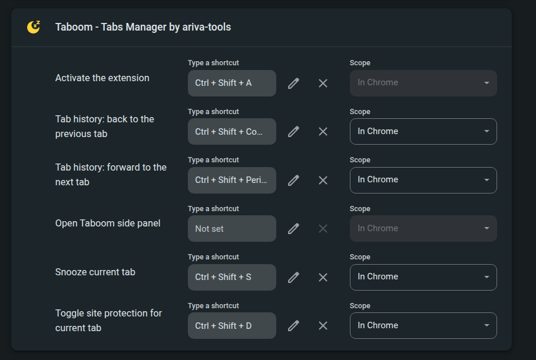

# Using Taboom - Tabs Manager

Pictures of each feature: [Features](FEATURES.md).

## Concepts

| Term | Meaning |
|---|---|
| **Snoozed** | Tab discarded from memory via `chrome.tabs.discard()` — or a tab Chrome restored at startup and has not loaded yet (it reports `status: "unloaded"`, not `discarded`). Same thing either way: no memory held, stays in the tab strip, Chrome reloads it when you click it. |
| **Protected** | Site excluded from automatic snoozing (and marked `autoDiscardable: false` so Chrome's own Memory Saver skips it too). |
| **Awake** | Open tab that is loaded (neither discarded nor unloaded). |

Snoozing never closes tabs. Closing only happens when you explicitly close.

**Seeing snoozed state in Chrome's own tab strip:** extensions cannot style the native tab strip. Enable Chrome's indicator instead: `chrome://settings/performance` → turn on **Memory Saver** — discarded tabs get a dotted ring around their favicon and a hover card.

## Verifying memory is actually freed

Snoozing uses `chrome.tabs.discard()` — Chrome kills the tab's renderer process, the same thing Memory Saver does. To see it with your own eyes:

### Chrome Task Manager (simplest)

1. Open a memory-heavy page (YouTube, Gmail, Figma…), let it load.
2. Press `Shift+Esc` (or Menu → More tools → Task Manager). Find the row `Tab: <page title>` and note its **Memory footprint** — often 100–500 MB.
3. Snooze the tab from Taboom - Tabs Manager.
4. The row **disappears from Task Manager** — the renderer process is gone; that memory is returned to the OS. The tab itself stays in the tab strip.
5. Click the tab → the row reappears as it reloads.

### chrome://discards (detailed)

1. Open `chrome://discards`.
2. Table lists every tab: **Discarded** column shows ✔ for snoozed tabs, plus last-active time. Sanity-check that Taboom - Tabs Manager's Snoozed filter agrees with this table.

### OS level (optional)

Watch total Chrome memory in the system monitor (`htop`, Activity Monitor, Windows Task Manager) while bulk-snoozing dozens of tabs — totals drop within seconds as renderer processes exit.

### What NOT to expect

- The tab-strip **hover card can lie**: it shows a cached screenshot and a stale "Memory usage" number sampled before the discard, and Chrome only shows the "Inactive tab — freed up X MB" treatment for its own Memory Saver discards, not extension discards. Trust Task Manager / `chrome://discards`, not the hover card.
- Savings per tab vary wildly — a static article costs little; a web app costs hundreds of MB. The extension deliberately shows counts, not "MB saved" — Chrome gives extensions no reliable per-tab memory API.
- The snoozed tab's scroll position and form state may be lost on reload — that's why protection rules exist for state-heavy sites.

## Side panel (main UI)

Open by clicking the Taboom toolbar icon, or `Ctrl+Shift+Space`.

Panel position (left or right) is a global Chrome setting: `chrome://settings/appearance` → **Side panel**. Extensions cannot set it, and top/bottom docking does not exist for side panels.

- **Search** — focused on open; matches title, URL, hostname and tag names; multiple words all must match (`github rust`). A `#word` token matches tags only, by prefix (`#wo` finds *work*) — see **Tags** below.
- **Filters** — All / Awake / Snoozed / Protected, with live counts, and the **Tags ▾** dropdown chip (see **Tags**).
- **Scope & sort** — **All open windows**, **Current window** or **Parked windows** (see below); recent / oldest / title / domain.
- **Row click** — focuses the window and activates the tab (snoozed tabs reload).
- **Visual states** — each window's active tab has an accent left edge + bold title; snoozed tabs are dimmed with a ⏸ title prefix and `SNOOZED` badge. Hovering a row shows its full address, under it its state badges in their colors (snoozed, protected, kept alive, pinned, 🔊) and, when it has tags, a **Tags:** line of colored pills.
- **Hover actions** — ⏸ snooze, 🛡 protect/unprotect site, ✕ close.
- **Checkboxes** — select several tabs, then bulk Snooze / Protect / Close from the bottom bar. Closing more than one tab asks for confirmation.
- **Quick launch (▦)** — a popover headed **Quick launch** with a **Close** button (like the ☰ menu), then one view per thing worth switching between, each a tab with its count: **Windows** (only with two or more windows, or a parked one), **Groups** (only once a group exists — the first one comes from a row's **Move to group ▸ New group…**; the view's own **+ New group…** row adds more), **Pins**, **Tags**, **Alive** and **Dupes** (only while they have members). A single view shows as a heading; with nothing at all (one window, nothing else) the ▦ button is greyed out.
- **Quick actions (☰)** — top-right menu (opening it closes any other popup: quick launch, history list, a dropdown): **Open Settings**, **Snooze inactive tabs now** (snoozes every tab the automatic-snooze rules allow, ignoring the inactivity threshold; the toast says how many), **Cleanup Duplicates (N)**, which runs *There can be only one* over every duplicated page at once (N = tabs it would close; greyed out when nothing is duplicated; confirmed first), and **Undo last remove in Parked windows**.
- **Select all** — checkbox left of the scope selector selects/unselects every tab currently shown (i.e. matching the active search and filter). Search first, select all, then bulk-act.

Keyboard: `/` focus search · `↑`/`↓` move selection · `Enter` activate · `Esc` clear search.

### Duplicates

The quick launch (▦) gains a **Dupes (N)** view whenever some page is open more than once — N counts pages, not tabs (hover the tab for the long name). Same page = same address without its `#fragment` (the query string counts). One row per page: title, `3 tabs · 2 windows`, a checkbox in front (all ticked when the view opens; hover a row for the per-window breakdown). Click a row to jump to the copy that would be kept. Above the rows, **All** ticks or unticks every page, and two buttons act on the ticked pages, each showing how many tabs it would close:

- **There can be only one** — one copy of each page survives across all windows, the rest close.
- **Cleanup each window** — one copy survives in every window; a window holding a single copy is untouched.

Which copy survives, in order: a pinned one, a kept-alive page, the tab in front of you, the active tab of its window, an awake one over a snoozed one, the most recently used, otherwise the first found. Pinned copies are never closed, even when they are not the keeper. **New Tab** pages (`chrome://newtab`, `about:blank` and friends) form one row and always keep one per window, whichever button you press. The row's ⋯ menu runs either cleanup for that page alone. The titlebar's ☰ → **Cleanup Duplicates (N)** is the shortcut: *There can be only one* over every duplicated page, no view, no ticking.

A confirmation lists how many tabs close and names any window that would close with them (its only tabs were duplicates). There is no undo inside Taboom; Chrome's `Ctrl+Shift+T` reopens closed tabs.

Tab history works from any tab, no panel needed: `Ctrl+Shift+,` back · `Ctrl+Shift+.` forward (`Cmd` on Mac). Same trail as the panel's ◀ ▶ buttons and the History context menu. When the active tab changes outside the panel (these shortcuts, Ctrl+Tab, a click in the tab strip), when the panel opens, and when the view changes (filter, scope or sort), the list scrolls so the current row sits at the top — with its **Split** or tab-group header above it — as far as the list can scroll. Activating a row from the list itself only scrolls as little as needed, so the list never jumps under the click.

### Parked windows

A window you do not need right now but do not want to lose can be **parked**: Taboom saves its tabs (order, pinned tabs, tab groups with their names and colors, which tab was active) and its own name, color and pin, then closes it. Nothing is loaded while it is parked — no memory, no reloads.

- **Park** — the window header's ⋯ / right-click menu (Group by window) or the quick launch's window row menu → **Park window…**. A dialog asks first and says where the window goes; tick **Don't ask again** to skip it from then on (**Settings → Ask before parking a window** turns the question back on). The only open window cannot be parked — closing it would close Chrome.
- **Find them** — the scope selector gains **Parked windows**. The quick launch (▦) **Windows** view also lists them under a **Parked (N)** heading below the open windows, newest first, with a grey dot, `N tabs · M groups · parked <date>` and the tab titles on hover; its label counts both kinds together: *Windows (3)* for two open and one parked. Click a parked row to restore it as a new window (asked first); its ⋯ / right-click menu is the parked window menu below plus **Show in Parked windows**, which switches to the scope. **Rename window…** there edits the row in place. Each parked window is a group of rows with a `parked` badge; search, the sorts and groupings, and the **Protected** chip work on them like on live tabs (Awake / Snoozed hide: nothing parked is either). The window header shows the window's name, or *Parked <date>* when it had none; rename it from its menu.
- **Restore** — the parked window header's ⋯ (always there, even for a single parked window — which also keeps its collapse arrow) / right-click menu: **Restore window** rebuilds it as a new window with everything above (name, color and pin included); **Restore into this window** appends its tabs to the window you are in instead (groups recreated there). Either way the entry leaves Parked windows; park again if you change your mind. Restored tabs load when Chrome opens them — the page content itself was never stored.
- **Single tabs** — click a parked row (or right-click it) for its menu: **Move parked tab to ▸** a live window or a new one (**Move … to group ▸** for a tab group) opens it there and drops it from the parked window; **Open parked tab in ▸** opens a copy and keeps it parked; **Remove parked tab** drops it without opening. Tick several rows to act on them at once; a parked window whose last tab leaves disappears.
- **Into a parked window** — a live tab's **Move tab to ▸** submenu ends with a **Parked:** section listing the parked windows (newest first): pick one and the tab (or the ticked selection) is appended to that snapshot and closed, its pin kept. Several tabs, or a window that would close with its last tab, are confirmed first.
- **Groups** — a parked tab group's header (right-click) has its own menu: **Rename group…**, **Move group to ▸** / **Open group in ▸** a window (the tabs arrive as a Chrome group with the same name and color) and **Remove parked group**.
- **Remove** — **Remove parked window / group / tab** drops it without opening anything. Every removal can be undone, newest first: the **Undo remove (N)** button in the toolbar while you are in the Parked windows scope, **Undo last remove** in the parked window menu, and **Undo last remove in Parked windows** in the ☰ quick actions menu (works from any scope, also when nothing is parked any more). A removed group or tab goes back into its parked window (or stands on its own if that window is gone).
- **Several at once** — tick parked rows, then open any ticked row's menu: Move / Open / Remove act on the whole selection. The bottom bar only counts them there (its tab actions are hidden).

### Tags

A tag is a colored label on a page address (without its `#fragment`), like a keep-alive mark is a timer on one: it survives a restart, it shows on every tab of that page, and on a parked copy of it. Any page with an address can carry one, Chrome's own pages and the Taboom settings page included — except the New Tab page, which every new tab shares. A tag can also sit on a whole site, or on a pattern: a tab carries the tags of every entry covering it.

- **Tag a tab** — row menu (or a selection's menu) → **Tag URL…** opens a checklist at the click, the same one as Settings: one checkbox per tag (ticked when the tab has it; over a selection, ticked when all of them have it), tick or untick as many as you like, the list scrolls past a screenful, then **Apply** (or Enter; greyed out until something changed) writes them in one go — **Cancel** or ✕ drops the ticks and brings the row menu back, Esc drops them too, and a click elsewhere with ticks pending asks whether to apply or discard them; **Tag domain…** (next to it, web pages only) opens the same checklist for the row's host — the tag lands on every page of the site; a tag a page only gets this way (or from a pattern) shows ticked and locked in **Tag URL…**, with the entry it comes from in the tooltip: edit that entry in Settings → Tagged page rules. A new tag is made inside the picker: the row under the ticks takes a name, one of the nine colors (same palette as tab groups) and **Add** (or Enter in the name) — the tag joins the list at once (every page sees it) and comes back ticked when the row's checkbox is on, but like any tick it reaches the tab only with **Apply**; Cancel keeps the tag and leaves the tab alone. Names are unique (case does not matter), up to 24 characters, no `#` — a name that breaks a rule is said under the row and nothing is added. An untick that would take a tag off **more than one open tab** — a domain entry, a selection — is said before it is written: a dialog names the tag, how many tabs lose it and which (the first five); **Apply** goes ahead, **Cancel** brings the picker back with your ticks as they were. Ticking a tag on never asks.
- **Where a badge comes from** — a pill reads plain when the tag sits on the page itself, `⌂ work` when it comes from a domain entry (Tag domain…, `example.com`, `*.example.com`) and `✱ work` from a pattern or prefix entry (`https://x.com/a/*`, `https://www.example.com/`); the page's own entry wins when several apply. The hover tip's Tags line shows the same.
- **See it** — a solid pill in the tag's color after the plain state badges (*protected*, *kept alive*, *pinned* …) on the row (white text, dark on yellow and orange); as many pills as the line holds beside the host (a search hit always among them), then *+N* for the rest — five short tags may all show, one long one shows alone with *+4*; the count follows the panel's width. The row's hover tip ends with a **Tags:** line of every pill.
- **Filter** — the **Tags ▾** chip shows only tagged tabs and opens a picker with one tick per tag and its count. No tick = any tag; ticks = any of the ticked ones (OR). The chip reads *Tags*, the tag's name with its dot, or *2 tags*; **Reset selection** under the ticks clears them.
- **Search** — `#work` (prefix) finds tabs tagged *work*; the matching pill gets a ring. Plain words match tag names too (`work` finds tagged tabs and titles with *work*). Both kinds combine: `#bills invoice`.
- **Group by tag** — the Sort select gains **Group by tag**: one header per tag with its color square, a tab under its first tag (tag-list order), untagged tabs under **No tag** last.
- **Quick launch (▦) → Tags (N)** — one row per tag: `N tabs · M windows` (or *no open tab*). Click a row to filter the list to that tag; its ⋯ / right-click menu offers **Rename tag…** (in place), **Tag color ▸** and **Remove tag**.
- **Page right-click menu** — **Taboom → Tag page ▸** lists the existing tags as checkboxes for the page under the cursor (no new-tag row there — make tags in the panel's picker or in Settings).
- **Settings → Tags** — two tables in the Keep Tabs Alive shape. **Tags**: number, an on / off switch (off keeps the tag and its pages in the table — struck through on the tagged page rules, not offered in their picker — but hides it everywhere else — badges, chip, search, grouping, menus — until switched on again), color dropdown, name (click to rename), how many pages carry it, **Remove**; an **Add** row (name + color); drag a row by its ⋮⋮ grip onto another to reorder — the list order is the order of a tab's badges, of the Tag URL… checklist and of the Group by tag headers (dragged down lands after the target, up lands before it). Click **Color**, **Tag** or **Page rules** in the header to sort (ascending, then descending, then the stored order again), or **#** to go straight back to the stored order; the `#` column keeps showing the stored position. The sort is saved at once. **Tags order in pickers** (a dropdown in the card) decides how every tag list you pick from is ordered — the Tag URL… checklist, the Tags ▾ picker, the quick launch's Tags view, the page menu's Tag page ▸, the Add-page dropdown: **Stored order** (default, the drag order), **Tag name (A–Z)**, **Most used first** (pages carrying it) or **Sorted table** (whatever this table is sorted by right now). Badges on a row always keep the stored order. Dragging is off while a sort is active. **Tagged page rules**: number, an on / off switch (off keeps the entry in the table, muted, but it tags nothing — no badge, no chip, no search hit, no inherited tick — until switched on again; its Tabs count still shows what it would cover), address (click to edit — an exact page `https://app.example.com/board`, an address ending in `/` for every page under it (`https://www.example.com/` is the whole site, `https://a.test/docs/` the docs), a host `example.com` for every page on it, `*.example.com` for the host and its subdomains, or a pattern with `*` anywhere like `https://github.com/ariva/*/test`, `*` matching anything, `/` included; hover for what the entry covers), the page's tags as colored chips — the first three, each with a ✕ that takes it off (when that reaches more than one open tab a confirm names them first; the same for an untick in the picker), then *+N* for the rest — and a **Tags ▾** button opening a picker with one tick per tag (it scrolls past a screenful), **Tabs** — how many open tabs the entry covers right now (hover for their titles; counted on every render, so it follows a write and a page open, not a tab you open meanwhile), **Remove**. Click **Page / domain / pattern**, **Tags** (by the row's first tag) or **Tabs** in the header to sort (ascending, then descending, then the stored order again), or **#** for the stored order; the `#` column keeps the stored position and the sort is saved at once; an **Add** row tags an address, a host or a pattern without opening it — an address already listed (in any of its spellings: `youtube.com/#x` is `https://youtube.com/`) is refused with *"… is already listed — edit that row instead"* under the row, and so is editing a row onto another row's address; junk gets *Type an address, a host or a pattern*. **Remove all tags** (confirmed) empties both; every removal (a Remove, a menu's Remove tag, Remove all) is undoable, newest first — **Restore last removal** here (Settings only — the panel has no undo for tags). Unticking the last tag of a page just drops the page (nothing to undo).

### Split view (experimental)

Enable **Settings → Show experimental features**; needs Chrome 155 or newer (an older Chrome shows no split items). Chrome's split view shows two tabs side by side in one tab slot; Taboom lets you build such a pair from the list.

- **Two tabs** — tick two rows, right-click one of them → **Split 2 selected tabs**. The row you right-clicked stays where it is; the other tab is moved next to it (across windows too) and into the same tab group, then the two are split.
- **Any row** — right-click it → **Split with previous tab** / **Split with next tab** pair it with the row right above or below it in the list as shown (hover the item for that tab's title). These are the clicked row's own items: they are there whatever is ticked. An item is offered unless that tab is already split; a row from another window (the item says so: **Split with next tab (next window)** on the last row of a window), with another pin state or in another group is brought over first.
- **Rules Chrome sets** — exactly two adjacent tabs of one window, same pin state, same tab group, neither already split. Taboom gets the partner there: it is moved beside the tab you right-clicked, pinned or unpinned to match it, and put in (or taken out of) its tab group — only an already-split tab is refused. The pair gets a `split` badge and shows like a tab group in the list — a **Split** sub-header with a divided-window icon and a visible/total count (`2/2`; `1/2` when a search or filter hides the other), the rows nested under it, side by side whatever the sort (hover the header: the two tabs numbered, title and address); right-click either row → **Unsplit**, or right-click the **Split** header for **Unsplit** and the usual tab actions over both (Snooze 2 tabs, Close 2 tabs …).
- **Layout** — whether the pair sits left / right or top / bottom is Chrome's own split-view setting; extensions cannot choose it.
- **Chrome's split rules** (what `tabs.createSplit` checks, in this order; Taboom arranges the tabs so only the first two can bite): the same tab twice · a tab already in a split · different windows · one pinned and one not · different tab groups (none counts as a group) · not side by side in the tab strip. Allowed: both pinned, both in the same group. Pinning, unpinning, grouping or ungrouping one member of a split applies to both.

### Changing the key bindings

The browser-wide shortcuts are Chrome commands, so you change them in Chrome, not in Taboom's options: open `chrome://extensions/shortcuts`, find **Taboom - Tabs Manager**, click the pencil next to a command and press the new combination. Taboom registers five commands — open side panel, tab history back, tab history forward, snooze current tab, toggle site protection — and Chrome adds its own "Activate the extension" row (the toolbar-icon click). Snooze and toggle protection ship unassigned; give them a key here. Chrome rejects keys another extension already uses, and a shortcut set to "In Chrome" works only while a Chrome window is focused ("Global" works everywhere). The in-panel keys (`/`, arrows, `Enter`, `Esc`) are fixed.

## Automatic snooze

Every 5 minutes (configurable) the extension discards tabs that are **all** of:

- inactive longer than the threshold (default 60 minutes, from Chrome's own `lastAccessed`),
- not the active tab, not already snoozed,
- not pinned (default), not playing audio (default),
- not on a protected site, not kept alive, not the split-view partner of the active tab (it is on screen beside it),
- a normal `http(s)`/`file` page (Chrome internal pages are never touched).

Additionally, each window keeps at least 2 awake tabs (configurable, 0 = no limit) — oldest eligible tabs are snoozed first, so a window never ends up fully discarded.

Toggle and tune everything in **Settings** (side panel ☰ → **Open Settings**, or the extension's Options page).

No need to wait for the timer: **Settings → Automatic Snooze → Snooze inactive tabs now**, the side panel's ☰ → **Snooze inactive tabs now**, or right-click a page → Taboom - Tabs Manager → **Snooze all inactive tabs** snoozes right away every tab the rules above allow — not active, not pinned, not playing audio, not protected, not kept alive, not already snoozed, and the per-window minimum kept — as if each had already crossed the inactivity threshold (the "Inactive for" minutes do not apply), and reports how many tabs it snoozed. All three work even while **Automatically snooze inactive tabs** is unticked — the toggle only stops the timer.

## Protecting sites

- Side panel: 🛡 on any row.
- Right-click a page → Taboom - Tabs Manager → **Protect site**.
- Settings page: add rules manually.

Rule forms: `mail.google.com` (exact host), `*.github.com` (domain incl. subdomains) or a full address like `https://app.example.com/board` (that one page only — side panel row menu **Protect URL**). **Unprotect** on a tab removes whichever rules cover it. Protect sites that lose state on reload: editors, admin consoles, forms, terminals, conferencing. In **Settings → Protected Sites** each rule is a chip with a ✕ (hover it for what it covers — exact host, domain and subdomains, exact page — and the full pattern); click a chip's text to edit the pattern in place (Enter or click elsewhere saves, Escape cancels — the new text is read like the Add row, so `https://…` turns it into an exact-address rule; a blank, unchanged or already-used pattern is refused). Under the Add row, **Remove all protected sites** (confirmed first) empties the list, and every removal — a chip's ✕, an Unprotect from the side panel or page menu, Remove all — can be undone: **Restore last removal (N sites)** undoes the newest one first (hover it for the patterns that come back, the first 10 then …; the last 50 removals are kept; a pattern you re-added meanwhile keeps its current rule). **Settings → Data → Clear restore data** forgets this undo history for protected sites, keep-alive marks and removed parked windows at once (no prompt; disabled while there is nothing to forget).

## Keeping tabs alive

Some websites have short sessions: a bank, an intranet or an admin console logs you out after a few idle minutes, and a dashboard stops updating once its tab sleeps. Opening the tab later means logging in again or staring at stale numbers. Marking such a tab as *kept alive* reloads it on a timer, so the session is renewed before it expires and the page stays fresh. Protection only stops the snooze; keep-alive also reloads the page.

1. It is on out of the box: **Settings → Keep Tabs Alive → Keep marked tabs alive** (nothing happens until you mark a tab; untick it to switch the whole feature off).
2. Pick the **Default value** interval (1–90 minutes, default 20). It is copied onto each tab you mark from then on; changing it later leaves existing marks alone.
3. Mark a tab: right-click the page → **Taboom - Tabs Manager → Keep this tab alive** (a checkbox — click again to unmark), or the side panel row menu → **Keep alive**. The same menu then shows one toggle for the mark's state — **Pause keep-alive** (the reloads stop, the mark stays) or **Resume keep-alive** — plus **Remove from keep-alive**. These items only appear for a single tab: with several tabs selected the row menu hides them, so one click can never mark a whole selection for periodic reloads (unmark many at once from the Settings table).

Marked pages reload every interval ± 55 seconds (random, so many tabs do not reload at once) and are never auto-snoozed. A page open in several tabs reloads in **one** of them — a pinned tab first, otherwise the first one found across your windows — because the tabs share one session and one reload renews it; a mark's **Tabs** dropdown in the Settings table switches it to **All tabs**. The Settings table lists every mark, numbered, with a checkbox to pause / resume its reloads (a paused mark stays listed and still counts as kept), its own **Reload each** interval (changing it restarts the timer), the **Tabs** choice (**One tab** or **All tabs**), a live **Next reload** countdown and a **Remove** button. Click a mark's title or address to edit the address in place (press Enter or click elsewhere to save, Escape to cancel) — the way to turn a tab-made mark into an exact one by adding its `#fragment`; the interval and timer stay, and an address another mark already has is refused. A mark's title comes from the tab when marked (or the hostname when added by address) and is refreshed from the open tab at every reload, so it follows the page; editing the address of a hostname-titled mark renames it to the new hostname. Under the table, an **Add** row marks a page by its address without opening it (like Protected Sites): type `https://app.example.com/board` or just `app.example.com/board` (https assumed; a `#fragment` is kept and makes the mark exact), click **Add** — the mark takes the current **Default value**, shows the hostname as its title until a tab on that page reports one, and starts reloading as soon as such a tab is open. Only `http`, `https` and `file` addresses are accepted; an address already marked is ignored. **Remove all keep-alive marks** (confirmed first) empties the table, paused marks included; settings stay as they are. Every removal — a row's **Remove**, an unmark from any menu, **Remove all** — is kept: **Restore last removal (N marks)** appears next to Remove all and undoes the newest removal first, then the one before it, and so on (the last 50 removals are kept). Hover it for "Restore:" followed by the addresses that come back (the first 10, then …). Restored marks come back as they were (paused ones paused) with a fresh timer; a page you marked again in between keeps its current mark. The quick launch (▦) gains an **Alive** view with one row per mark, in the same order as Settings: click an open one to jump to it; a mark whose page is not open anywhere (tab closed, or it navigated on) is struck through with *not open*; click opens it in a new tab, and its ⋯ / right-click menu offers **Open**, the same Pause / Resume toggle and **Remove from keep-alive**.

Marks are kept by page address (a mark made from a tab drops the `#fragment`; one typed into Settings keeps it), so they survive a browser restart and apply to every tab on that address; a tab that navigates elsewhere is no longer kept. A page with unsaved form data may show Chrome's "Leave site?" prompt on each reload — do not mark those. No extra permission is needed: reloading a tab is free, the timer is the existing `alarms` permission.

### How a mark works, by example

A mark is **not** a tab id and **not** a window: it is the page address (the `#fragment` dropped when marked from a tab, kept when typed into Settings), plus its own interval, an optional pause and the time of the next reload.

1. **Marking.** Right-click a tab on `https://dash.example.com/board#tab=2` → **Keep this tab alive**. Taboom stores `https://dash.example.com/board` with the current **Default value** (say 20 minutes) and a next reload time 20 minutes ± 55 seconds from now. The tab's id is not stored.
2. **Reloading.** Every 30 seconds a sweep looks for marks whose time has come and that are not paused. For each one it reloads **one** tab whose address (without fragment) matches — a pinned one if there is one, else the first found in window order (every matching tab when the mark's **Tabs** dropdown says **All tabs**) — then schedules the next reload: interval ± 55 seconds again. Marks whose time has not come are untouched.
3. **Two tabs, one mark.** The board is open in two windows → only one reloads (the pinned one, else the one in the first window); both once the mark's **Tabs** dropdown says **All tabs**. Close one → the other keeps reloading. Close both → the mark stays in the Settings table and in the Alive view (as *not open*), quietly waiting; open the board again tomorrow and it is kept without re-marking.
4. **Navigating away.** The board tab goes to `https://news.ycombinator.com/` → that tab is no longer kept (the context-menu checkbox clears); the board mark still exists for any tab that returns to that address.
5. **Same page or not?** Marked from a tab, `board#tab=2` and `board#tab=5` are the same mark. `board?view=5` is a different page and needs its own mark (only the fragment is dropped, the query stays). Hash-routed apps (`https://app.example.com/#/dashboard` vs `#/mail`) are the exception: type the address with its fragment into the Settings **Add** row and that mark covers that exact address only; a fragment-free mark still covers every fragment.
6. **Interval per mark.** Default 1 minute, mark the board → the board reloads every minute. Raise the default to 25 → the board stays at 1; the next page you mark gets 25. Change the board's own dropdown to 10 → its timer restarts and the countdown shows about 10:00 +/- 55s.
7. **Pausing.** Untick the row's checkbox → the sweep skips it and the countdown reads **paused**; the page is still a mark (menu checkbox stays ticked, still never auto-snoozed) but its row loses the **kept alive** badge and the Alive view greys it out with "paused". The side panel row menu (also from the Alive view) shows **Pause keep-alive** while running and **Resume keep-alive** while paused — never both. Ticking or unticking restarts that mark's timer from now, so a reload that fell due while paused does not fire at once.
8. **Switching off.** **Keep marked tabs alive** unticked, or an empty table → no timer, no reloads, no menu item. The marks stay in storage; ticking **Keep marked tabs alive** again restarts every mark's timer from now.

The ± 55 seconds is random per reload so that ten dashboards on the same interval do not all reload in the same second.

### Which tab reloads

What one sweep does for a mark whose time has come:

1. Collects every open tab whose address matches the mark (a mark without `#fragment` matches the address without its fragment; a mark typed with one matches that exact address).
2. **Tabs = One tab** (the default): a **pinned** matching tab reloads if there is one; otherwise the **first matching tab found** — Chrome lists tabs window by window, each window's tabs left to right, so that is the leftmost match in the first window that has one. Two unpinned copies in two windows → the one in the first window. One of them pinned → the pinned one. Both pinned → again the first found.
3. **Tabs = All tabs**: every matching tab reloads together.
4. The mark is re-armed once (interval ± 55 s) and takes the reloaded tab's title. No matching tab → nothing reloads, the mark re-arms quietly.

Caveat: "first found" follows Chrome's internal window order, which is roughly the order the windows were opened — not the window you used last, and not the tab you looked at most recently. If the wrong copy keeps reloading, pin the one you want kept, close the other, or switch the mark to **All tabs**.

### Protected vs. kept alive

Both keep automatic snooze away from a page; they differ in what else happens. Pick one; a page can also be both (the side panel row then shows both badges).

| | Protected | Kept alive |
|---|---|---|
| Automatic snooze | never | never |
| Manual snooze (row ⏸, bulk bar) | still works | still works |
| Reloads the page | no — the page is left exactly as it is | yes, every interval ± 55 s |
| Matches | site rules: a host, `*.domain`, or one exact address | one exact address (`#fragment` dropped from tabs, kept when typed) |
| Good for | pages that lose state on reload: editors, forms, terminals, calls | pages that must stay loaded *and* fresh: dashboards, sessions that time out |
| Row indicator | shield button + green **protected** badge | green **kept alive** badge |
| Where to manage | Settings → Protected Sites | Settings → Keep Tabs Alive |

Rule of thumb: protect what would break if reloaded; keep alive what would go stale or log you out if it were not.

## Context menu

Right-click any page → **Taboom - Tabs Manager**: Snooze this tab · Protect site · Keep this tab alive · Tag page ▸ (once a tag exists) · Snooze all inactive tabs.

## Privacy

Everything runs locally: no server, no telemetry, no content scripts, no host permissions. **Settings → Delete all Extension data** wipes everything stored (settings, protected sites, keep-alive marks, parked windows, tags, undo data); **Restore default settings** resets only settings and appearance and keeps those.
